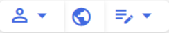
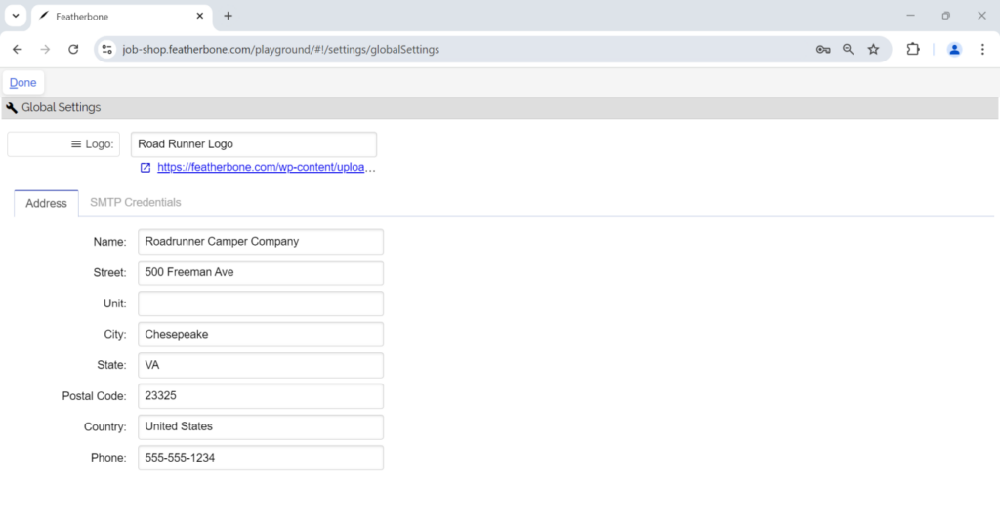
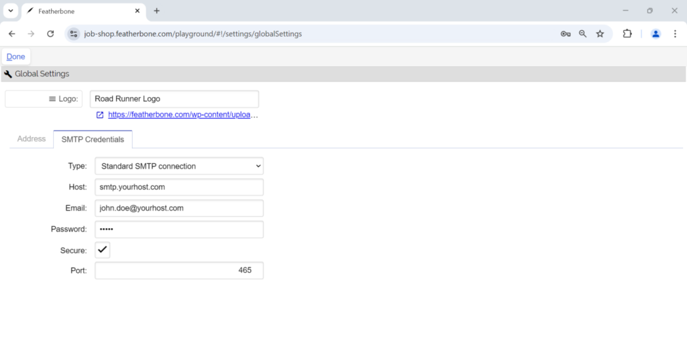

# Concepts

## What is Featherbone?

In this guide you will see references to both “Featherbone” and “Job Shop,” which may be a bit confusing at first. How is Featherbone different from Job Shop? Featherbone is the framework that provides the structure and navigational elements to build a database application, like the way you use your favorite spreadsheet program to build a series of tables and data. Job Shop is a specific application built on Featherbone to help manufacturers run their business. When we talk about Featherbone, we’re talking about general principles that apply throughout the system. When we talk about Job Shop, we’re talking about a specific feature built in the Job Shop application to support the manufacturing cycle.

Job Shop itself has three editions: Standard, Professional and Enterprise where Standard provides functionality needed for material control, Professional adds tools for operations management, and Enterprise adds capabilities for more mature companies such as physical inventory count. This document will call out when certain features are only available in certain editions.

## Global settings

The button group on the “Home” workbook menu contains the button to global settings. Note this button is only enabled for user accounts assigned the administrator role.

Clicking this button opens the following dialog box.

When set, the logo prints on all forms to tailor Job Shop to your business. It must be a web address that points to a JPEG file. Any other file type will generate an error when printing forms. Likewise, the address appears on all printed forms. Both settings are optional.

Select SMTP credentials for email settings used to send printed forms via email.

If SMTP is used, enter credentials as pictured for an email account that will be used to send all forms. If you choose Gmail, no credentials will be required, but instead when a user attempts to send a form, they will be prompted with their own Gmail account and credentials to send mail, and it will be sent from their Gmail account.
