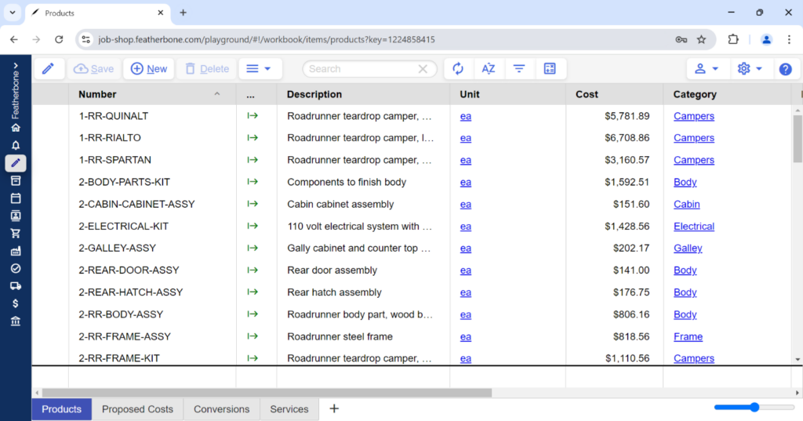
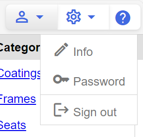
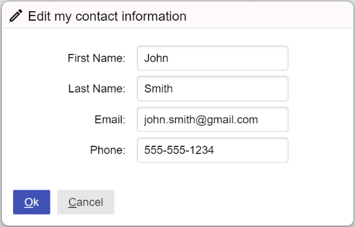
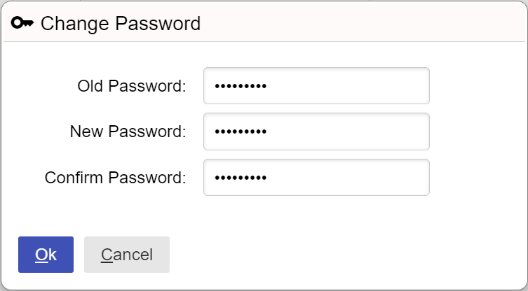
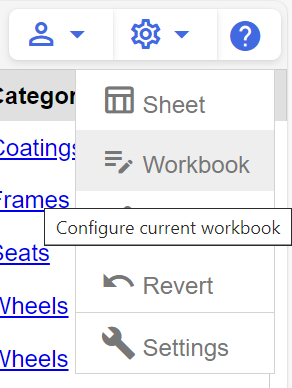
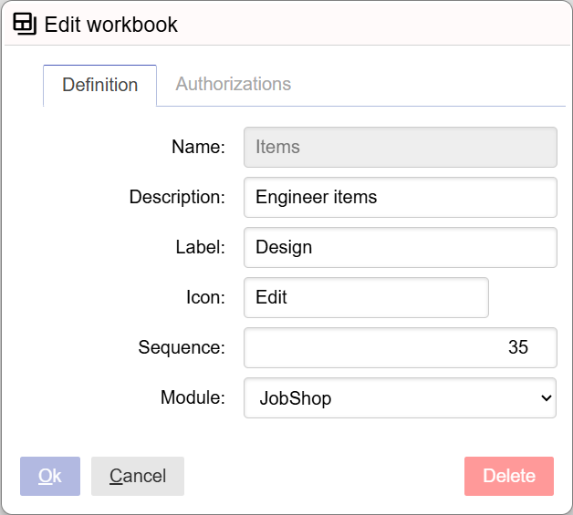
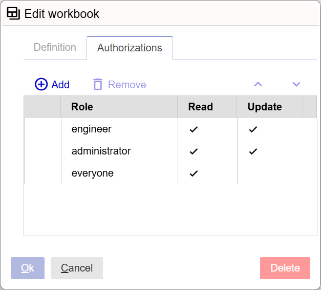
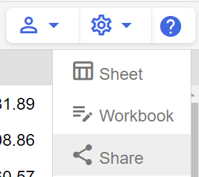
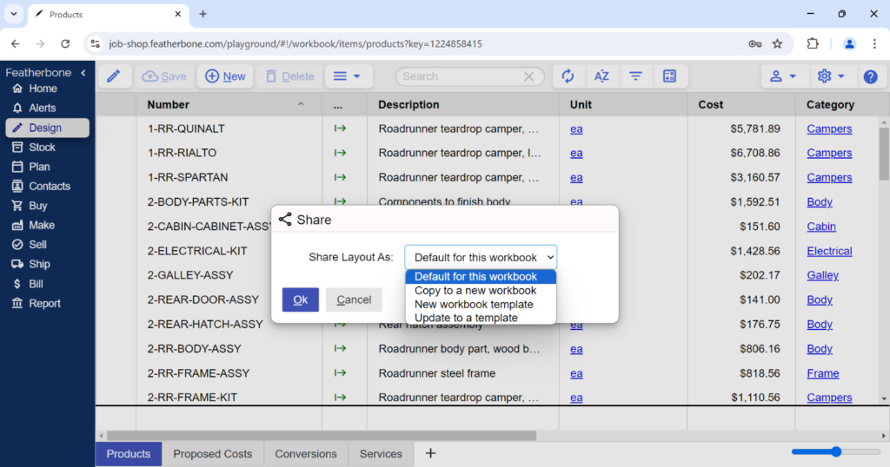
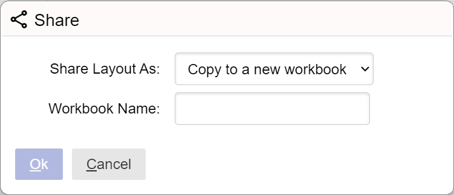

# Workbooks

## Navigation

Click on a menu item on the list to open the respective workbook.

*Design workbook menu selected*

Clicking on the arrow on the top of the menu will collapse it, as shown below, to enable more space for worksheets on the screen. Click on the arrow again to expand the menu. Hover over a menu item to show the descriptive title of the workbook.

Note that the web address at the top of the workbook can be copied and sent to other people in your organization to take them directly to the same page if they have access to the workbook.

## User settings

The user account menu is the third button from the right at the top of every page. From this menu, you have three menu items that work as follows:

This item lets you view and change contact information linked to your account.

Use this item to change your password.

Choose this item to log out of the application. Featherbone keeps track of how many users are logged into your database. This will free up a concurrent user license.

## Managing workbooks

Adding a workbook is a global function that requires administrator privileges. To learn how to do this, please go to managing workbook templates.

You can navigate to workbook settings on the second button from the right where you will be presented with the workbook settings dialog which has two tabs.

Here you can change the description, override the label that appears on the menu button, the icon that is used and the sequence it appears in the list. Also note if you have administrator privileges you can entirely delete the workbook here.

The authorizations tab controls who can see and alter the workbook. From here you can assign standard Job Shop business roles or individual user accounts. Job Shop comes pre configured with appropriate roles assigned to workbooks, but users with roles that have update access to the workbook are allowed to edit the list.

Roles that have read access are allowed to see the workbook, along with all pages within it. Read only roles are allowed to rearrange column headers, change filters, sorting and subtotals, however the workbook will reset to its original state when the page is refreshed. In addition, read only users are not allowed to open the workbook or worksheet settings dialogs to make changes.

When a user has a role with update access to a workbook, Featherbone will remember any local changes they have made to column headers, filters, sorting and subtotals with their user account. These settings will stick when the page is refreshed or when they log into another machine. Furthermore, users with update privileges are allowed to edit both workbook and worksheet settings and share their changes with others. See sharing changes for more information.

Note: If a user has a role to read or update a workbook but does not have a role necessary to read the content of one or more of the worksheet pages, they will not see any data listed. To see data the user must be granted a role allowed to read it. See role authorization for more information.

## Sharing changes

If you have update privileges for a workbook and you make changes to one or more worksheets including adding new pages, changed columns, filters etc., you can share your changes with the rest of the organization by selecting Share on the workbook management menu.

When sharing you are prompted to select one of four options:

This option will make your workbook configuration the default for all users. For read only users, or users with update privileges who have made no changes to their workbook, they will see your configuration on the next page refresh. For users with update privileges who have made any changes, they will only see the default if they revert their existing workbook.

Select this option to make a new workbook that is identical to the current one. This is a good option if you want to make a version of the workbook that you have modified for a particular user group, but don’t want to have to start from scratch to build it. When choosing this option, you will be prompted to give the new copy a name.

After giving it a name and clicking “Ok” the copy will immediately appear.

This option will make an internal workbook template that can be used to generate new similar workbooks. This is a good option if, for example, you intend to make a series of workbooks for the shop floor that are pre-filtered to work center specific criteria. Like copying a workbook, you must give the template a name.

You must have the administrator role to create new workbooks using templates. To learn how to do this, please go to managing workbook templates.

Choose this option to update an existing template to reflect the current workbook configuration.

Note: this option only updates the template, not workbooks that were previously created with the template.

Users who have update privileges to a workbook can choose this action to revert their workbook personalization back to the default configuration.
