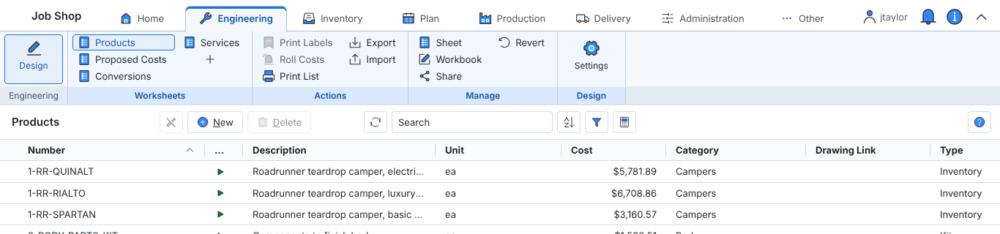

# Workbooks

## Navigation

Workbooks are opened from the ribbon across the top of every page. Each tab after Home is a category, such as Engineering or Inventory, and holds that category's workbooks as buttons: click a tab to see them, and a button to open one. Clicking a tab only changes which buttons show; nothing opens until you click a button. Hover over a button to see the workbook's description.

The Home tab holds what does not belong to any one workbook: the dashboard, your account, adding workbooks, global settings, and the view controls with the zoom and the help contents.

The arrow at the top right collapses the ribbon to its row of tabs, leaving more room for the worksheet; double-clicking a tab does the same. While it is collapsed, clicking a tab drops its buttons down over the page until you pick one, click away or press Esc. Click the arrow again to keep the ribbon open.

Note that the web address at the top of the workbook can be copied and sent to other people in your organization to take them directly to the same page if they have access to the workbook.

## User settings

Your account is on the Home tab, in the Accounts group.

**Info** lets you view and change the contact information linked to your account.

**Password** changes your password.

**Sign Out** logs you out of the application. Featherbone keeps track of how many users are signed in to your database, so signing out frees a concurrent user license.

## Managing workbooks

Adding a workbook is a global function that requires administrator privileges. To learn how to do this, please go to managing workbook templates.

With a workbook open, click Workbook in the ribbon's Manage group to open the workbook settings dialog, which has two tabs.

Here you can change the description, override the label that appears on the menu button, the icon that is used and the sequence it appears in the list. Also note if you have administrator privileges you can entirely delete the workbook here.

The authorizations tab controls who can see and alter the workbook. From here you can assign standard Job Shop business roles or individual user accounts. Job Shop comes pre configured with appropriate roles assigned to workbooks, but users with roles that have update access to the workbook are allowed to edit the list.

Roles that have read access are allowed to see the workbook, along with all pages within it. Read only roles are allowed to rearrange column headers, change filters, sorting and subtotals, however the workbook will reset to its original state when the page is refreshed. In addition, read only users are not allowed to open the workbook or worksheet settings dialogs to make changes.

When a user has a role with update access to a workbook, Featherbone will remember any local changes they have made to column headers, filters, sorting and subtotals with their user account. These settings will stick when the page is refreshed or when they log into another machine. Furthermore, users with update privileges are allowed to edit both workbook and worksheet settings and share their changes with others. See sharing changes for more information.

Note: If a user has a role to read or update a workbook but does not have a role necessary to read the content of one or more of the worksheet pages, they will not see any data listed. To see data the user must be granted a role allowed to read it. See role authorization for more information.

## Sharing changes

If you have update privileges for a workbook and you make changes to one or more worksheets including adding new pages, changed columns, filters etc., you can share your changes with the rest of the organization by clicking Share in the ribbon's Manage group.

When sharing you are prompted to choose one of four ways to share the layout:

**Default for this workbook** will make your workbook configuration the default for all users. For read only users, or users with update privileges who have made no changes to their workbook, they will see your configuration on the next page refresh. For users with update privileges who have made any changes, they will only see the default if they revert their existing workbook.

**Copy to a new workbook** makes a new workbook that is identical to the current one. This is a good option if you want to make a version of the workbook that you have modified for a particular user group, but don’t want to have to start from scratch to build it. When choosing this option, you will be prompted to give the new copy a name.

After giving it a name and clicking “Ok” the copy will immediately appear.

**New workbook template** makes an internal workbook template that can be used to generate new similar workbooks. This is a good option if, for example, you intend to make a series of workbooks for the shop floor that are pre-filtered to work center specific criteria. Like copying a workbook, you must give the template a name.

You must have the administrator role to create new workbooks using templates. To learn how to do this, please go to managing workbook templates.

**Update to a template** updates an existing template to reflect the current workbook configuration.

Note: this option only updates the template, not workbooks that were previously created with the template.

Users who have update privileges to a workbook can click Revert in the ribbon's Manage group to return their workbook personalization to the default configuration.
