# Worksheets

## Navigation

Within a worksheet there are several click and hover actions that can be taken to either get more information from the content displayed or act on it. The image below highlights some of these:

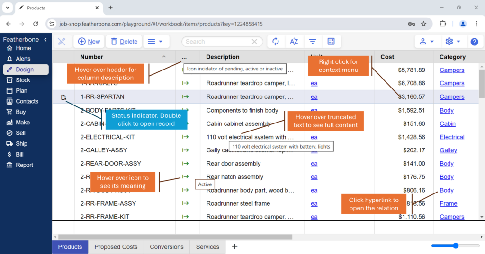

Most notably if you double click on the leftmost status column next to the turquoise call out above, or any other cell that is not a hyperlink, you will be taken to the detail of the record as shown below.

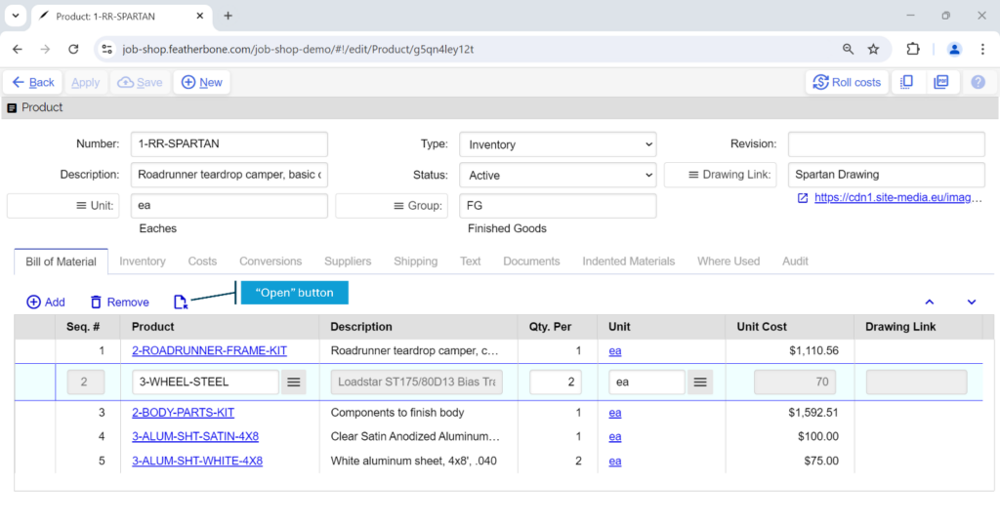

The rows on child tables can be further opened by selecting a row and clicking the “Open” button. This takes you to a form another level below showing additional details not visible in the table row.

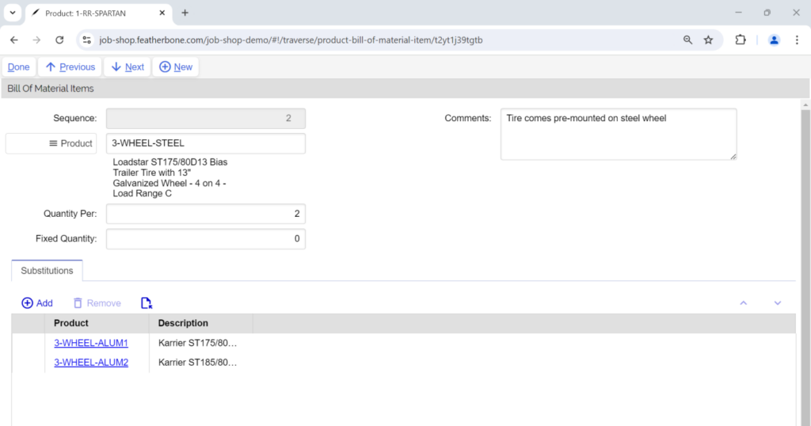

From this form you can continue to drill into additional detail. In this case you could open the steel wheel product by clicking the Product button and “Open,” or by clicking on the hyperlinks of either of the substitute products. There is no limit to the traversal depth and at any point you can traverse back by clicking the “Back” or “Done” buttons.

## Inline editing

Worksheets have a mode control in the upper left corner that is disabled by default for most pages.

Users with update privileges to a workbook can enable this button by navigating to the worksheet configuration dialog. Go to the workbook management menu with the gear icon and select “Sheet.”

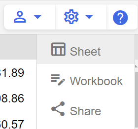

Once in the configure worksheet dialog, click “Enable edit mode” and “Ok” to enable the button.

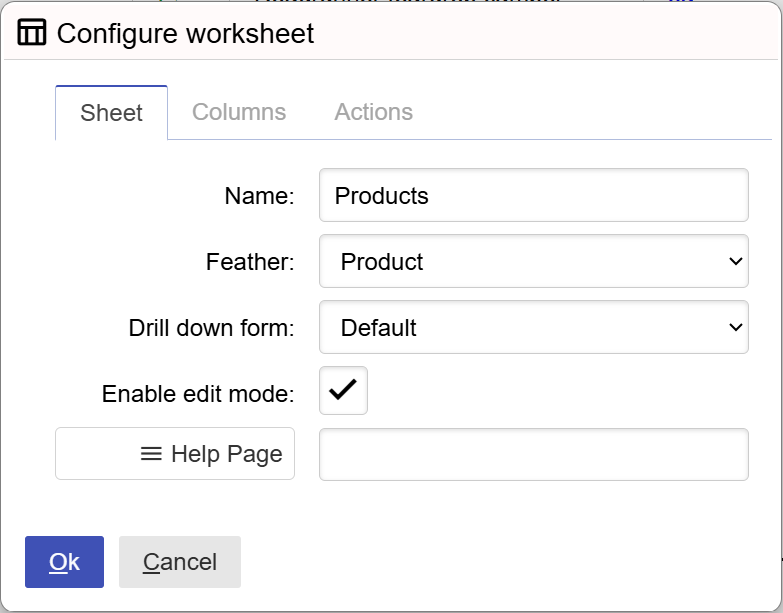

Now the worksheet can be changed to edit mode by clicking the mode button as shown below.

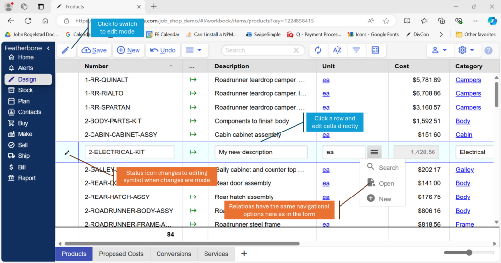

You may edit multiple rows at a time in edit mode before clicking “Save” to commit all your changes.

Note that edit mode does come with a small performance trade off since for each row the entire document, including child records, must be loaded from the server to properly handle edits. In view mode only the attributes that are visible are requested so data loads faster. This is why most worksheets have edit mode disabled by default.

## Altering columns

Column positions on worksheets can be changed by dragging and dropping the column, and widths can be changed by dragging the separator line between columns. For users with privileges to update a workbook, these changes will be remembered with their user profile. For read only users the column layout will revert to the default the next time the page is refreshed.

Columns can be removed and added by going to the columns tab on the configure worksheet dialog.

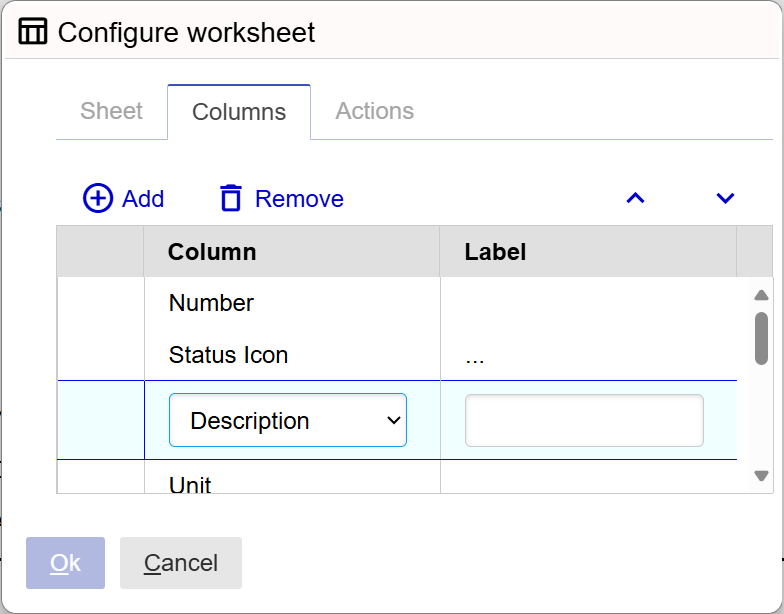

Click a row and then “Remove” to remove a row. Click “Add” to add a new one. By default, new columns will appear at the end of the list, but you can use the up arrow to move their position from within this dialog.

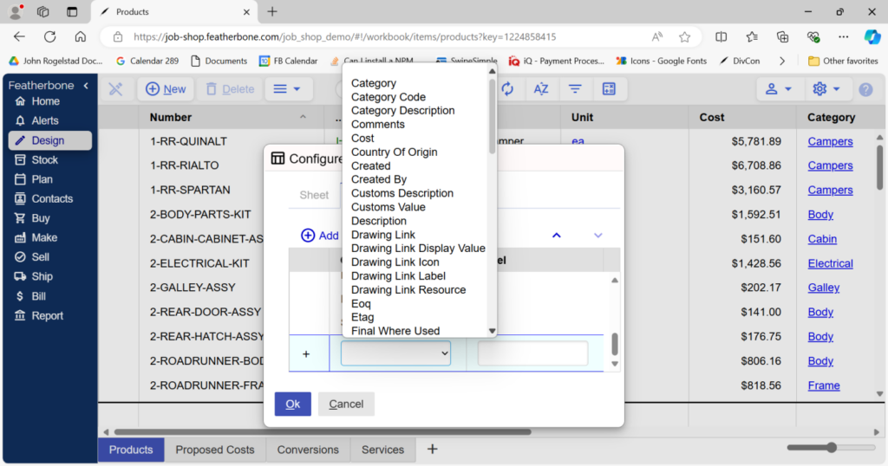

## Searching and filtering

The search bar at the top of every list does a case-insensitive match on the text of every visible column within that page. In the example below results are returned where “wire” is found within the number and description columns.

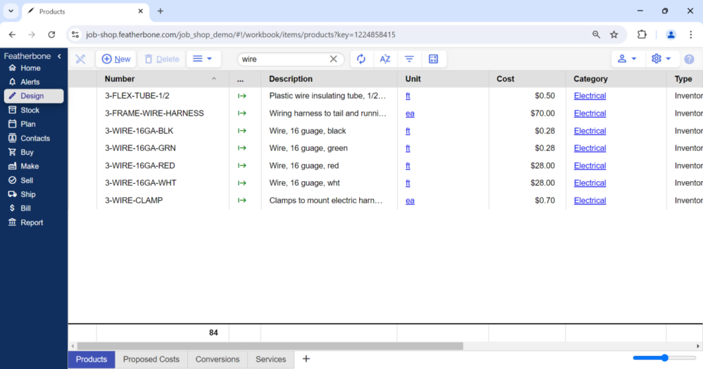

Because search is a matching function, it supports regular expressions which can get quite sophisticated. We will only show a few examples of some of the more commonly used techniques:

Use the | symbol between two texts to do a search between one text OR another.

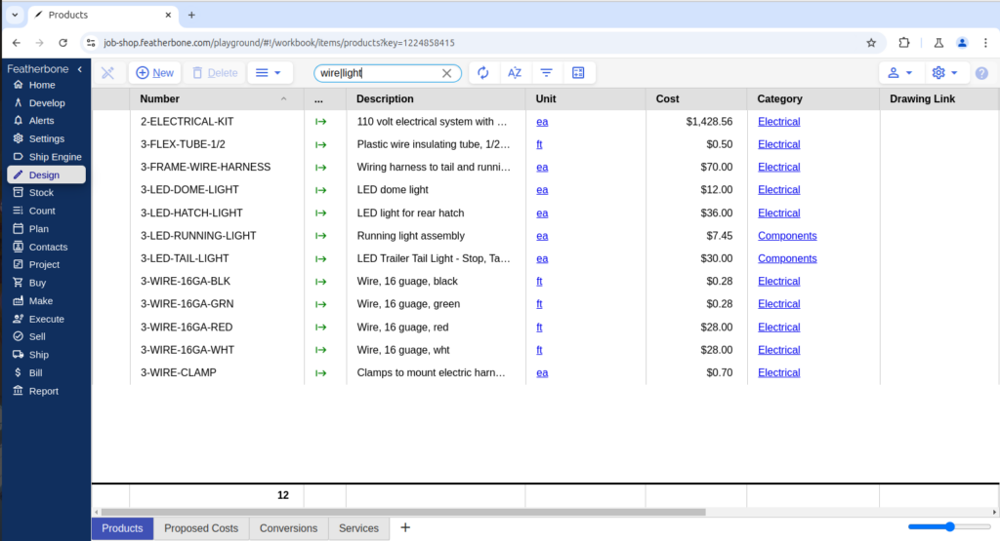

Use the ^ symbol in front of a word to search for text that starts with it.

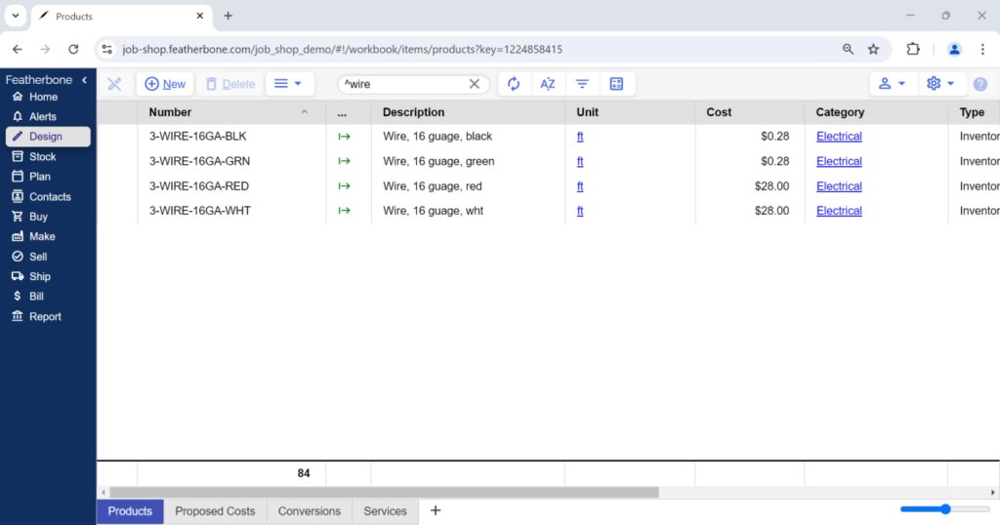

Use the $ symbol after a word to search for text ending with that word.

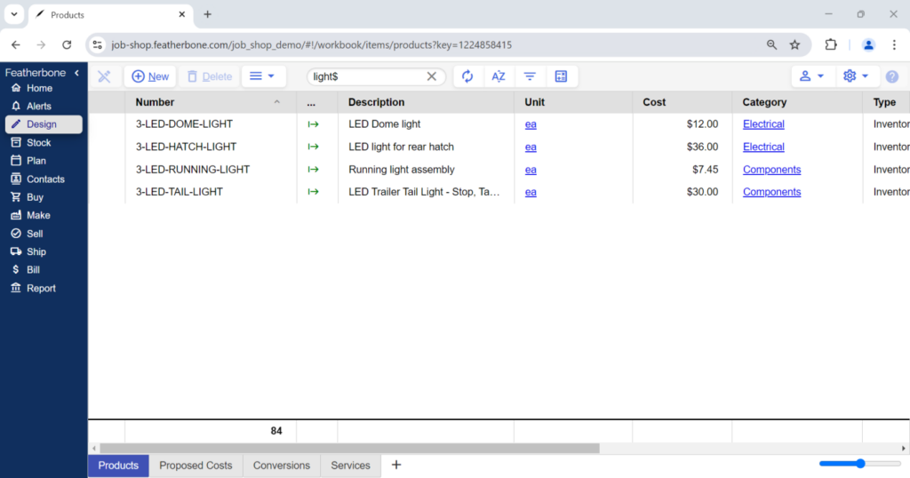

Regular expressions are a standardized concept in computer science and are not unique to Featherbone. An internet search on “regular expression tutorial” will return many results that further explain the powerful, and potentially complex, capability of this matching logic you can use.

Otherwise, it’s notable that search content is not remembered by the system when the browser is refreshed. For searches to stick, you need to use filters.

Click on the “filter” button in the toolbar to open the filter dialog.

Filters allow you to narrow the page results to criteria met by specific columns. You can filter on any attribute in the list’s feather or attributes in relations to the feather (for example, Category on Product). In the case below the filter is on products in the electrical category that cost more than 10 dollars.

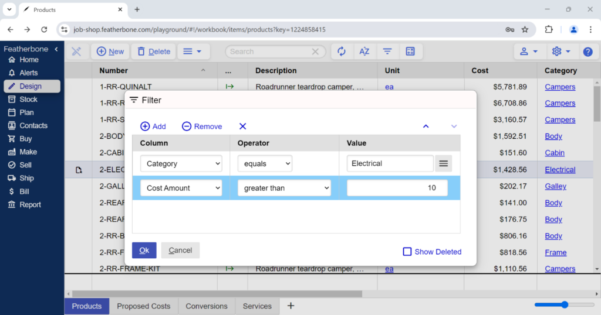

The result of this search is pictured below.

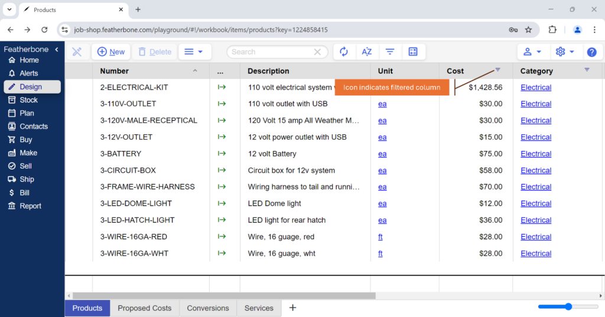

Icons in the header indicate which columns are filtered. Hovering over an icon shows what the filter criteria are.

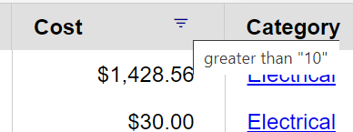

Note that you can apply filters even on columns that are not visible, though it follows that filters on columns not shown will not be indicated in the header. Also, filters can work in conjunction with search results to further narrow a filtered search.

For users with workbook update privileges, the last filter applied will be remembered when the page is refreshed.

If you combine the ability to add and configure columns with filters, you can construct highly tailored searches and lists. In the next example our user wants to find out who has updated electrical products records this week. She adds the “Updated” and “Updated By” columns to her list, and builds this date-based filter:

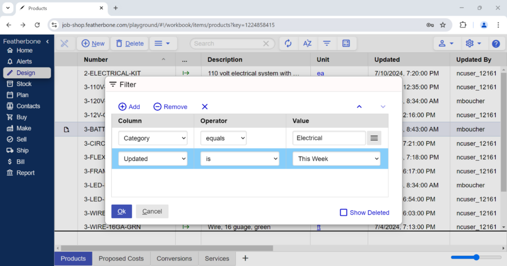

Which on our “playground” example database yields the following result:

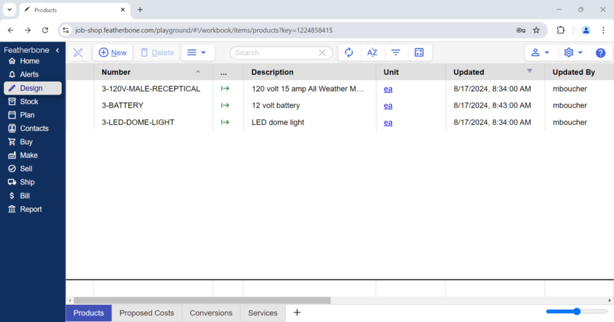

There is also an option when filtering to show deleted records. When records are deleted in Featherbone, in most cases it does a soft delete, which means the records are flagged as deleted internally but are still present and just not shown in lists and searches except when specifically called for. Being able to show deleted records is useful for auditing purposes.

Note many records such as products, sales orders and shipments cannot even be soft deleted once a transaction has been performed against them.

To show deleted records, just check the box at the bottom of the filter list.

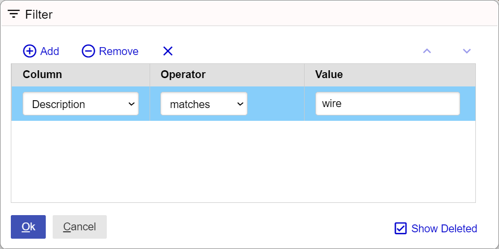

The result is shown below where the deleted records are clearly marked with a red block icon, and strikethrough across the row. Note in this case we still have the updated columns from our previous layout so we can also see who deleted the records, and when.

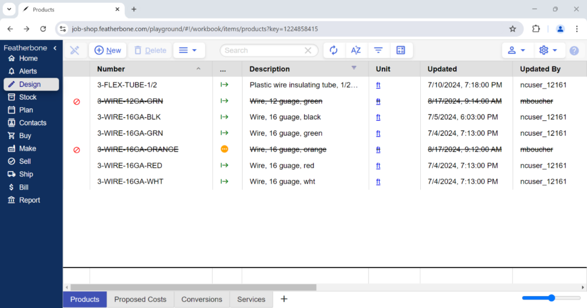

It’s worth mentioning that Featherbone uses a technique called “lazy loading” to improve usability. This means that it initially only loads a few more records than can be made visible on your screen. As you scroll down the list, it will continue to load more records as you scroll until all of them are loaded. This prevents you from having to wait a long time to load lists that may be thousands or tens of thousand of records. Typically, it’s expected if there are that many records in the system, you will search or filter until you narrow to a short list.

## Sorting

The sorting functionality in Featherbone works like filtering. Click the “sort” button in the toolbar to open the dialog.

In the example below, we’re sorting on category ascending, then by cost descending.

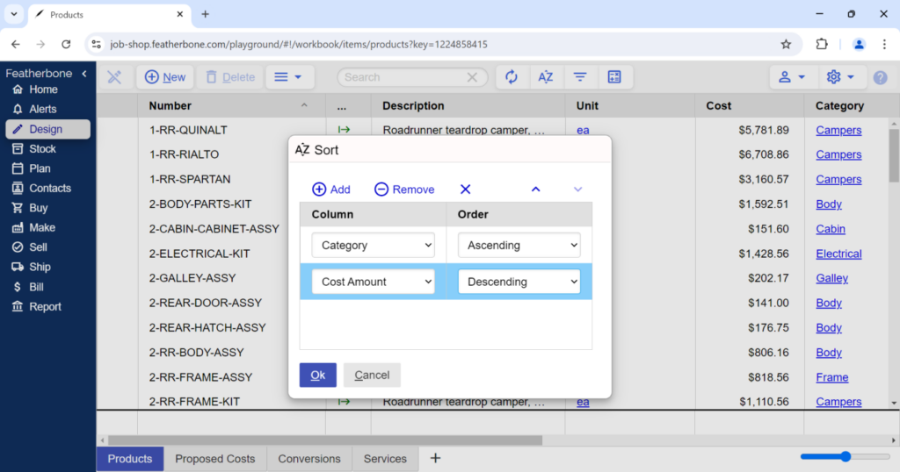

And we get the following result:

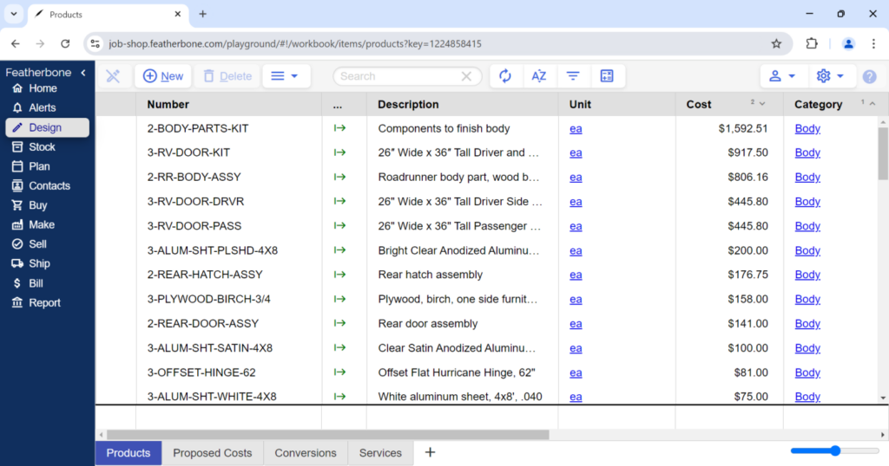

A closer look shows that the two columns being sorted on are numbered, indicating the sort order, with arrows indicating whether the sort is ascending or descending.

As with filtering, you can choose to sort on columns which are not visible, which will therefore not be marked this way. Finally, sort is remembered for users who have update privileges for the workbook.

## Subtotaling

The subtotal button is the rightmost button on the middle button group on the toolbar.

Clicking it opens another dialog like filter and sort, except in this case you are allowed to choose a subtotal operation where the options vary depending on the attribute selected.

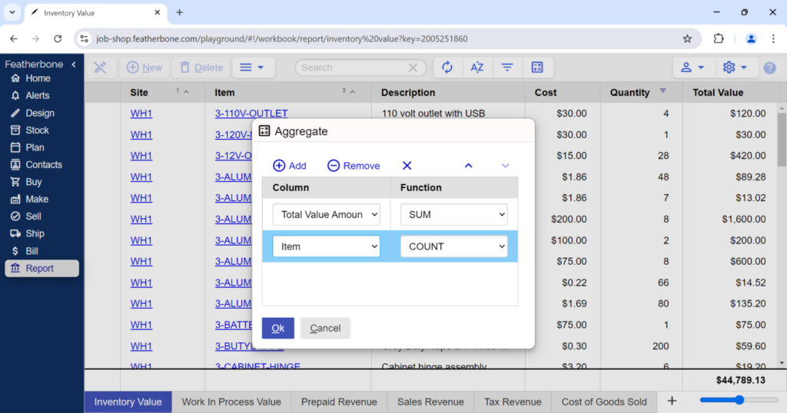

On the Inventory Value worksheet in the Financial Report workbook, we already had a sum of the total value. In the screenshot above, we add a count of items in inventory (it was already filtered to show only products with a quantity greater than zero). The result is shown below with the count of items at the bottom of the item column, and the sum of the value of inventory at the bottom of the total value column.

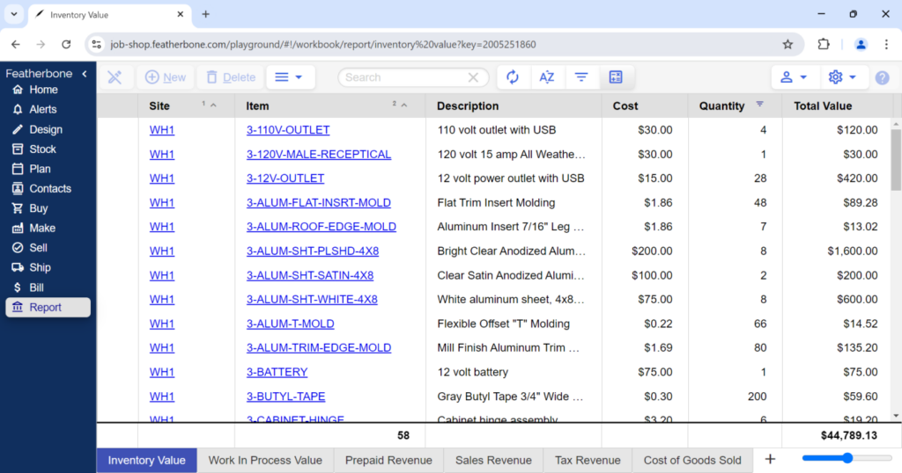

Of course, mathematical operations such as sum and average are only possible on numeric columns, while count, min and max are possible on both numbers and text columns. Relation columns only allow counting.

As with filter and sort, subtotals are remembered with the view for users with update privileges on the workbook.

## Adding and removing worksheets

Users with update privileges on a workbook can add a new worksheet by clicking the right most “+” tab and will be presented with the dialog below.

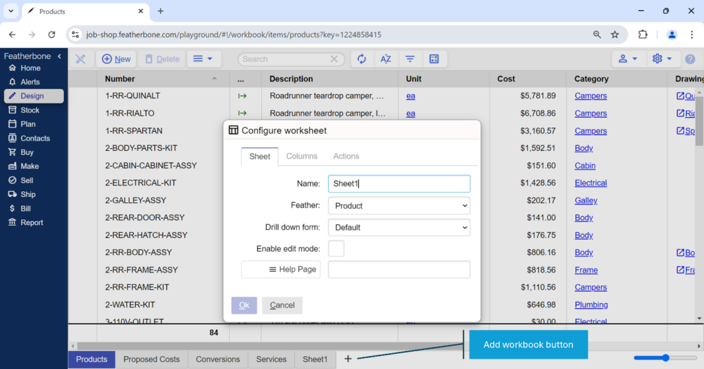

By default, the feather will be the same as the active worksheet from where the add button was clicked. From here the worksheet should be renamed something meaningful. Columns will also be copied from the active worksheet. However, if a different feather is chosen only columns common to both the original workbook and the new feather will be preserved. Once you click “Ok” the new worksheet becomes part of the workbook. Any filters, sorting or subtotals need to be applied to make it useful for its intended context.

For other users to see and use this new worksheet, the revised workbook needs to be shared as the new default. Other users with update privileges may need to revert to the new default to see it if they have also already made changes that have effectively customized their view of the workbook. Otherwise, users with read only privileges will automatically see the changes since they always see the current default after a page refresh.

The worksheet configuration can be edited any time by users with update privileges via the workbook management menu by selecting “Sheet”.

Initially the “Sheet” tab is shown in the dialog. To change columns, click on the “Columns” tab.

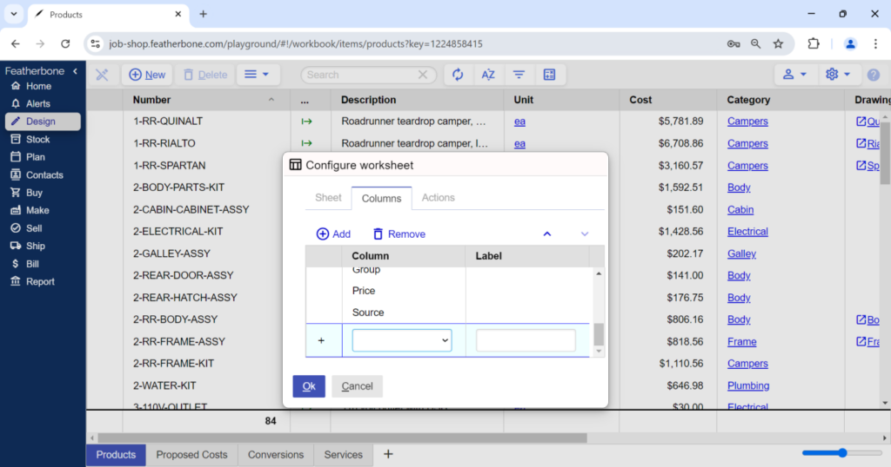

From here you can add a column (as shown), remove a column, set a custom label and move the column order by selecting a row and clicking the up or down arrows above the label header. Note it is also possible to rearrange the columns by dragging and dropping them from within the list itself.

To remove a worksheet, click and drag the tab at the bottom of the page you want to delete to the right. The “+” symbol will change to a trash can. Drag the tab on to the trash can and you will be prompted with a confirmation dialog. Click “Ok” and the worksheet will be removed.

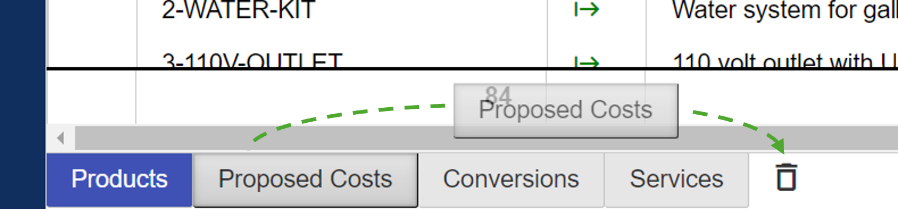

Note that you cannot remove the active worksheet, only non-selected worksheets can be removed as shown above.

## Actions

Every worksheet has an action menu, some with some actions specific to the feather being displayed, and a few standard actions applicable to all worksheets. Actions can either be accessed by the action menu at the top, or right clicking on a specific row as shown below:

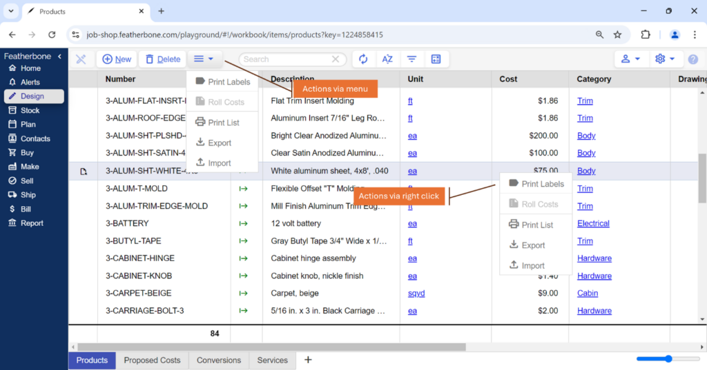

Actions specific to a particular worksheet are listed first, where these actions may be enabled conditional to data in the selected record. For example, in the above record “Roll Costs” is disabled because the selected product is purchased, in which case rolling costs does not apply.

There are three standard actions described below.

Prints the entire contents of the list. Note this will query all records in the search at once, so may take some time on large result sets.

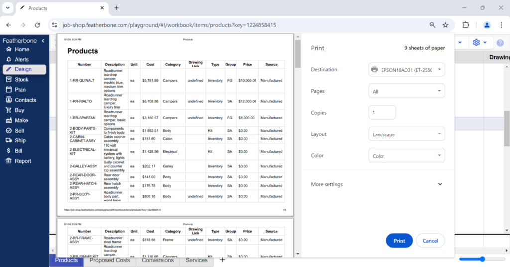

Also note, the format of the list auto sizes to accommodate columns shown and the width of the paper. It may be helpful to change to landscape printing, use a larger paper size, or reduce the number of columns shown if the columns are overly crowded.

You may export all the data in the list to a file in popular formats including Excel, Open Document Spreadsheet and JavaScript Object Notation (JSON).

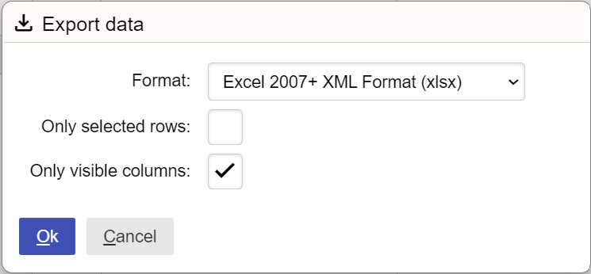

This can be useful to create highly tailored reports, but also if you intend to do some kind of mass editing that would otherwise be too tedious to do record by record in Featherbone, even using inline editing. Exported records can be imported from the same menu to apply mass changes to your records. Note, however, if the purpose is to mass update, it is a good idea to uncheck “Only visible columns” so that all data is exported rather than only the data you can see in the worksheet.

Use import to mass load new records or mass update existing records. The format of import files is very particular, we recommend you export all columns of a worksheet first to establish the format, then add or edit records in the exported file following the format provided.

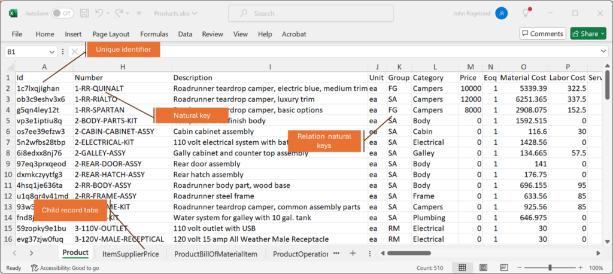

The above image of an Excel export with callouts displays a few things worth noting about the file format.

All records have a globally unique identifier. These are generated automatically if created in Featherbone. If you create new external records yourself this value can be anything, just be sure it is globally unique. In other words, no other records can share this value.

Most document records also have a key that is unique to the feather, which is meaningful to, and therefore more readable, for humans. Typically, this column is “code”, “number” or “name.” Since it is only unique to the feather, other feathers may have a natural key with the same value. For instance, there may be both a product “category” and “group” with a code “Finished Goods.”

Note, however, not all records have a natural key. For example, the feathers “Address” and “Contact” do not have this.

To make reading and managing exports and imports easier, relations use the natural keys as a reference in spreadsheet files. Note that the record with the natural key referenced must pre-exist for the import to succeed. For example, to import products with category of “Finished Goods,” that category must be created or imported in Featherbone first.

If a relation (such as address or contact) does not have a natural key, the Id is used as the reference.

When feathers have child records, these are represented as additional tabs on spreadsheets, which makes it possible to import complete document objects. Child records must reference the Id of the parent.

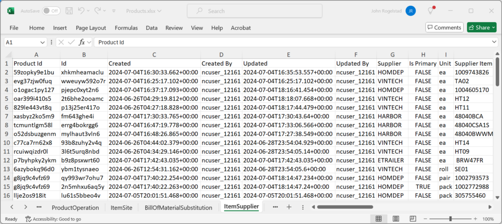

In the example of above of the child “Item Supplier” records of products, the Product Id references the parent in the first column.
