# Invoicing and payments

## Invoice actions

- **Send** — This will send a PDF version of the printed invoice form set in bill settings to the primary contact on the invoice. You have an opportunity to change the recipients, subject and edit the message body. The message body by default is populated with the default text specified in billing settings. After sending the Is Printed, Print Time and Printed By dates will be updated on the invoice the same as if it had been printed.

Send is only enabled if email settings have been configured in global settings. - **Print** — This will print a PDF version of the printed invoice form set in bill settings. After printing you will be prompted whether the print succeeded. If you confirm yes, the Is Printed, Printed Time and Printed By dates will be updated on the invoice. - **Open** — This will open a PDF version of the printed sales order confirmation form in a new tab. Print statuses will be updated on the order after opening. - **Download** — This will download a PDF version of the printed invoice to your downloads folder. Print statuses will be updated on the order after downloading. - **Apply payment** — When an active invoice is selected, this action opens a dialog that allows you to enter a reference number and amount to apply from cash, check, credit card or any other form of payment.

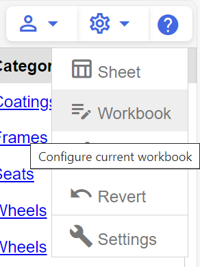

You can select multiple invoices to apply the payment to where the amount will be distributed from the oldest to the newest based ordered by the invoice date.

## Invoice header

- **Number** — A unique order identifier auto generated on save. All invoices start with “I-“.
- **Customer** — The customer you are selling to. When the customer is selected the site, primary contact, terms, ship method, and incoterms set on the customer will copy into the invoice.
- **Purchase Order** — The customer’s purchase order reference number.
- **Invoice Date** — The date the invoice was created.
- **Status** — See the article on the sales order lifecycle for details about sales order status.
- **Ship date** — On shipment invoices only. The date of the shipment that created the invoice.
- **Sales Order** — The sales order that the invoice is associated with. On prepaid invoices this is the link to shipment invoices to which pre-payments will be applied. on shipment invoices this is the sales order the shipment was made against.
- **Shipment** — On shipment invoices only. This is the shipment that created the invoice. The products and billed quantities will match the quantities shipped.
- **Unapplied** — On prepaid invoices only. The amount still available to be applied to shipment invoices.
- **Prepaid** — On shipment invoices only. This is the prepaid amount applied to the shipment invoice.
- **Subtotal** — The sum of all line-item amounts.
- **Shipping** — A manually estimated shipping charge.
- **Tax** — The sum of all tax rows.
- **Total** — The sum of subtotal, shipping and tax.
- **Paid** — The total of pre-payments (shipment invoices only) and payments applied.
- **Balance** — The amount due based on the total minus the amount paid.

## Invoice lines

All line information copies from sales orders when a sales order is related to or launches the invoice.

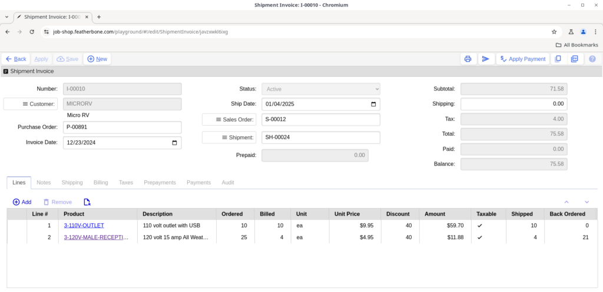

- **Line #** — An auto generated sequential number. Moving rows up and down will re-sequencing the lines.
- **Product & description** — Select from products that are active and marked “Is Sold.”
- **Ordered** — The quantity originally ordered on the sales order.
- **Billed** — The quantity billed on this invoice. On prepaid invoices this is the quantity you want to be prepaid.. On shipment invoices this is the quantity that was shipped on the shipment.
- **Unit** — The product’s unit of measure.
- **Price** — The price per unit. If there is a price set on the product, it will be copied in.
- **Discount** — The discount percentage applied to the price copied from the customer record.
- **Amount** — The order quantity multiplied by the price and subtracting the line discount.
- **Taxable** — Checked by default if both the customer and the product records are flagged as taxable. If true, this row is included in tax calculations in the tax tab.
- **Shipped** — The quantity shipped on the shipment (shipment invoices only).
- **Back Ordered** — The quantity remaining to ship after the shipment (shipment invoices only).

- **Notes tab** — Copied from the sales order
- **Audit tab** — Information about who created and last updated the line and when.

## Invoice notes

Billing notes that copy from the sales order and print on the default invoices forms.

## Invoice shipping

All ship to information copies from sales orders when a sales order is related to or launches the invoice. Otherwise values copy from the customer on manually created invoices.

- **Ship to** — The address where goods were shipped.
- **Ship method** — The ship method used to ship products.
- **Incoterms** — The incoterms define the responsibilities of exporters and importers in the arrangement of shipments and the transfer of liability involved at various stages of the transaction.

## Invoice billing

All bill to information copies from sales orders when a sales order is related to or launches the invoice. Otherwise values copy from the customer on manually created invoices.

- **Bill to** — Instructs your billing department where to send invoices and statements.
- **Contact** — The primary customer contact for the invoice.
- **Payment terms** — The agreed finance terms with the customer on this invoice.

## Invoice taxes

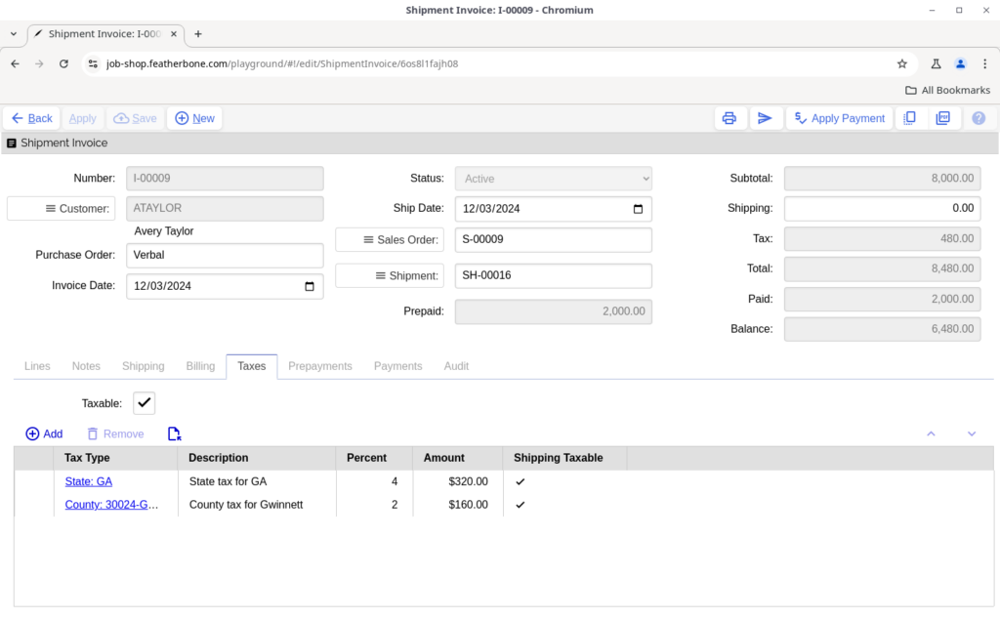

Tax rates are automatically imported and calculated on an invoice when it is flagged as taxable, when one or more lines with amounts are flagged as taxable, and there are tax rates set up that correspond with the bill to address on the invoice. By default the invoice is flagged taxable if the customer record is flagged as taxable. Likewise lines are flagged taxable when the products on them are flagged taxable. The shipping taxable flag on the tax lines determines whether the shipping cost is also taxed.

In the case of shipment invoices, as shown above, the tax types are copied from the sales order associated with the shipment from which the invoice was generated, and the calculations are based on the quantity that was shipped which is reflected as the billed quantity on line items..

> See also[How to use taxes](#how-to-use-taxes)

## Invoice prepayments

This tab lists prepayments from a prepaid invoice applied to a shipment invoice.

> See alsoPrepaid invoicesShipment invoices

## Invoice payments

This tab shows list all payments that have been applied to the invoice by the apply payment action.

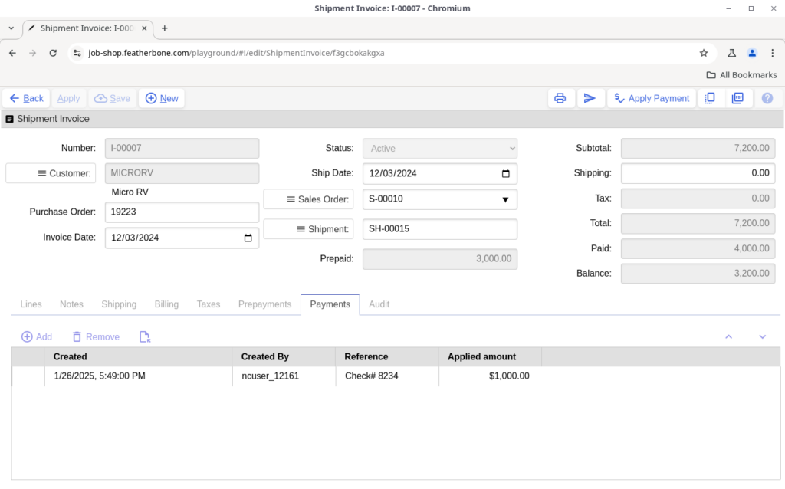

## Invoice audit

- **Sales Rep** — The employee that is responsible for the sales order associated with the invoice. It is copied from the sales order when a sales order is selected, or the invoice is generated from a shipment. In the case of a manually created invoice, if the currently logged in user account is associated with an employee flagged with “Is Sales Rep” equals true, then the sales rep will default to their employee account. Otherwise, the list of potential employees that can be assigned is filtered on all employees where “Is Sales Rep” equals true.
- **Created By** — The user account who created the invoice.
- **Updated** — The last time the invoice was updated.
- **Updated By** — The user account who last updated the invoice.
- **Is Printed** — Flagged true when the invoice has been successfully printed or downloaded.
- **Print Time** — The time the invoice was successfully printed or downloaded.
- **Printed By** — The user account who successfully printed or downloaded the invoice.

## How the billing cycle works

You use invoices to keep track of billing collections for products you have sold. They contain billing detail including but not limited to quantities, pricing, billing terms, delivery date and delivery information, so you know what was sold, when, and for how much. Active invoices are shown by default in the active invoices worksheet in the Bill workbook. You can create invoices manually from this worksheet, or automatically by converting an uninvoiced shipment into an invoice. Job Shop will help you populate a manual invoice quickly by copying customer and product information into the document when applicable. You can print an invoice form to paper or PDF to send to the customer, and you apply payment to invoices to keep track of what has been paid and what is still due.

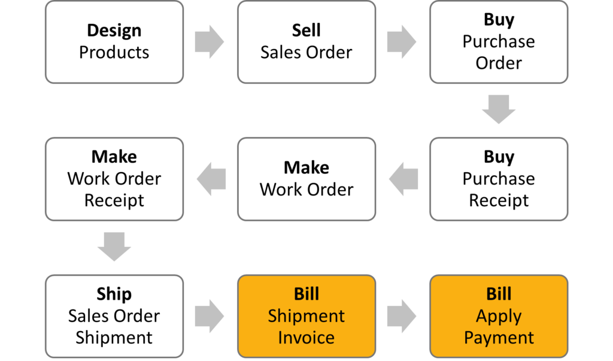

Note: your workflow patterns may differ. See alternate workflows for more information.

Invoices can be in one of the two states shown below where they generally flow from active to closed.

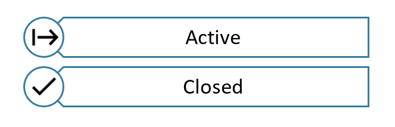

The statuses work as follows:

- **Active** — Invoices in this state have been should be sent to the customer to receive payment.
- **Closed** — An invoice changes to closed when the entire amount due has been been applied. At this point the invoice is read only for historical purposes and no further cash applications may be made on it.

Prepaid invoices are invoices against a sales order independent of shipping activity. They are primarily meant to be used as a mechanism to receive deposit before starting work. When a shipment is made against an order with one or more prepaid invoices and that shipment is invoiced, the amount of prepayments is credited toward the new invoice and subtracted from its total.

Below is an example of a prepaid invoice for a 25% down payment against a camper on sales order S-00010.

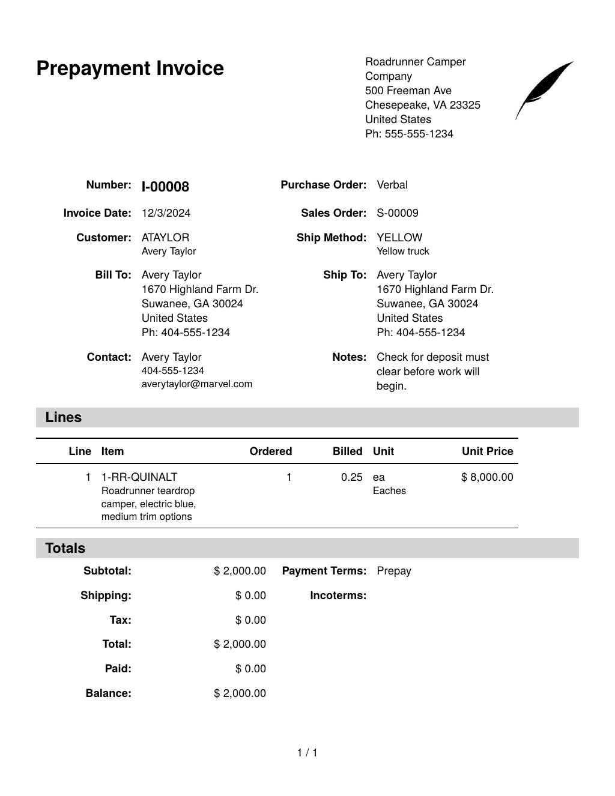

You create shipment invoices from the uninvoiced shipments worksheet by selecting one or more shipments and running the Create Invoice action. An invoice is created for the amount of goods shipped based on the pricing and terms on the sales order. Any unapplied prepaid invoices for the sales order that shipped are applied to the shipment invoice as shown below.

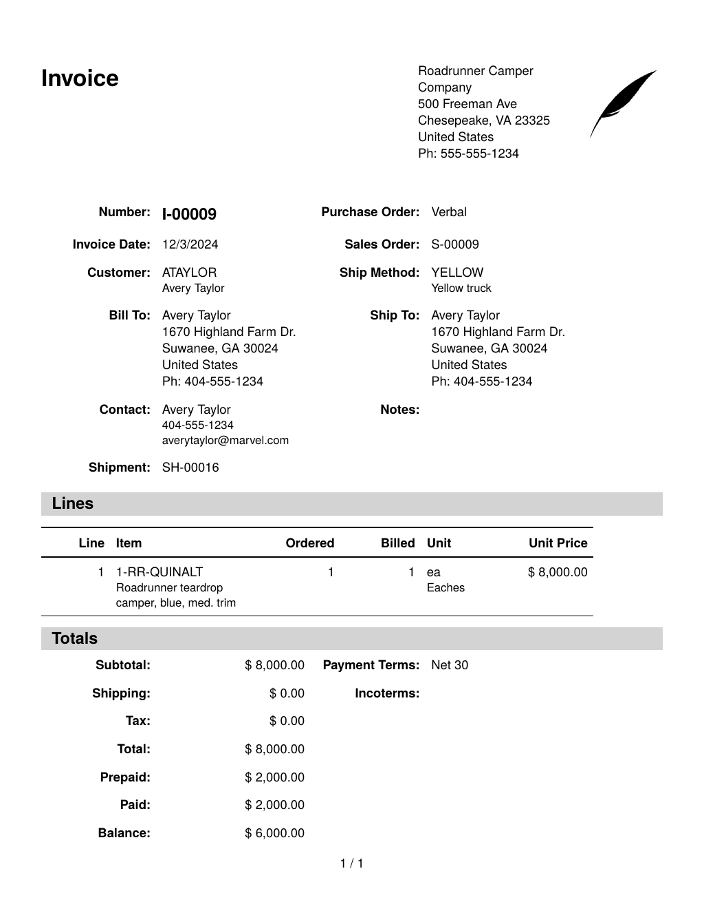

The product pricing in the electronic version of the form in Job Shop below agrees with printed form above.

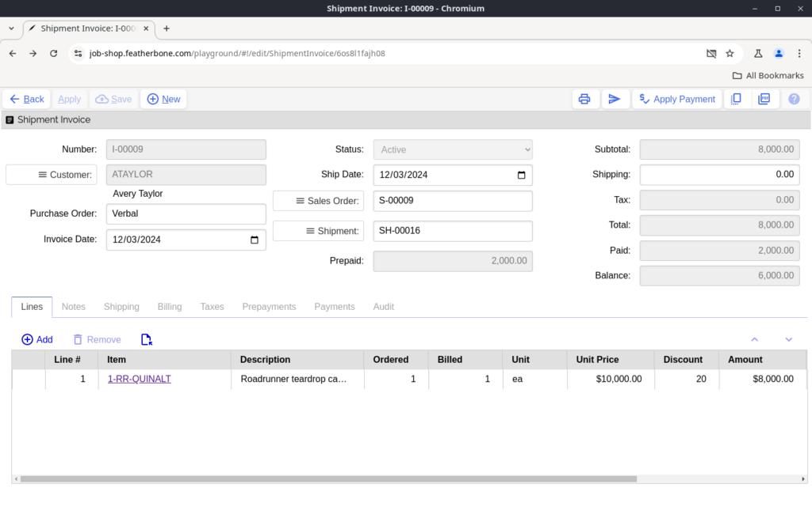

In addition, you can confirm the prepayments applied on the prepayment tab.

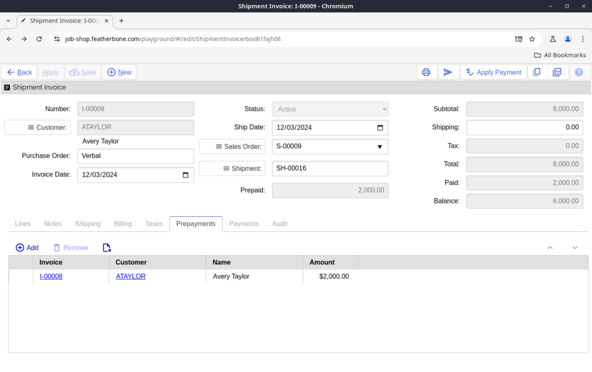

Similarly, if we jump to invoice I-00008, the applications tab confirms it was entirely applied to I-00009.

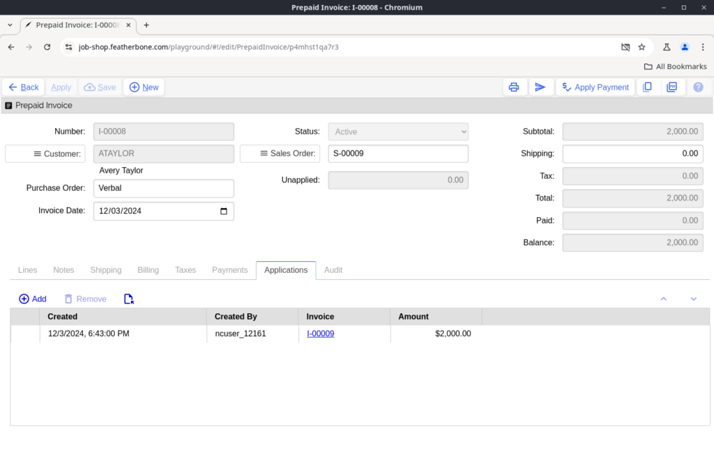

> See alsoHow the sales order cycle works[Sales order](#sales-order-header)[How the shipping cycle works](#how-the-shipping-cycle-works)Sales order shipmentInvoice

## Uninvoiced shipments

This worksheet lists all sales order shipments that have been shipped but have not yet been invoiced. Select a shipment and run the create invoice action to generate an invoice from the shipment and its associated sales history.

> See also[Bill settings](#bill-settings)[How the billing cycle works](#how-the-billing-cycle-works)[Sales history](#sales-history)

## Active invoices

This worksheet list all active invoices with outstanding payments due.

- **Create prepaid invoice** — Create a new prepaid invoice from scratch.

Note: you can also create prepaid invoices from a sales order

- **Send** — Attach and send an invoice via email.
- **Print** — Print the invoice.
- **Open** — Create a PDF of the invoice and open it in a new browser tab.
- **Download** — Download a PDF of the invoice.
- **Apply payment** — Opens the apply payment dialog to record a payment transaction against one or more selected invoices.

Job Shop allows you to delete invoices in certain cases. When deleting a shipment invoice any prepayment applications will be undone, sales history will be removed, and the associated invoice will be marked as not invoiced. You cannot delete a prepaid invoice that has been applied toward a shipping invoice..

> See also[Bill settings](#bill-settings)Email settings[How the billing cycle works](#how-the-billing-cycle-works)

## Unused prepayments

This worksheet lists prepaid invoices where the prepayment has not been completely applied to shipment invoices.

> See also[How the billing cycle works](#how-the-billing-cycle-works)

## Closed invoices

This is a historical list of closed invoices that can be viewed for investigation and auditing purposes. Closed invoices are read only, so no action can be taken on them.

## Sales history

Sales history is generated by invoices represented as a row for each type of income item including products sold, taxes and shipping. This list is useful for researching and totaling sales by particular categories such as total shipping amounts, sales of particular product, or sales within a certain date range.

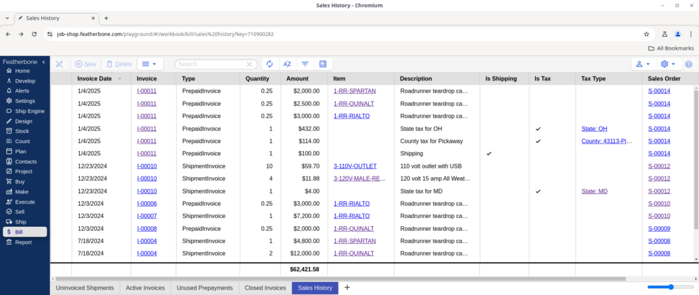

## Bill settings

- **Standard Invoice** — The layout to use when creating a PDF for a regular invoice.
- **Prepaid Invoice** — The layout to use when creating a PDF for a prepaid invoice.
- **Shipment Invoice** — The layout to use when creating a PDF for a shipment invoice.
- **On Release** — An action to automatically run when a shipment invoice is created.
- Do nothing: don’t take any additional action.
- Email: send an email with the invoice PDF attached.
- Download: save the invoice PDF to your downloads folder.
- Open PDF: open the invoice PDF in a new browser tab.
- Print: print the invoice PDF.
- **Mail Text** — The default text to appear in the body of email when you send an invoice.
