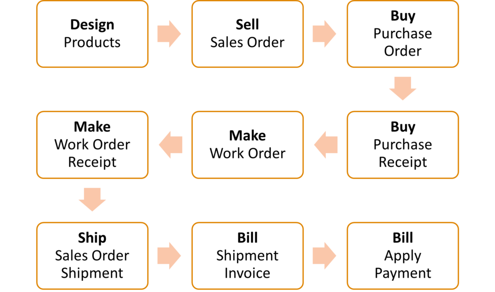
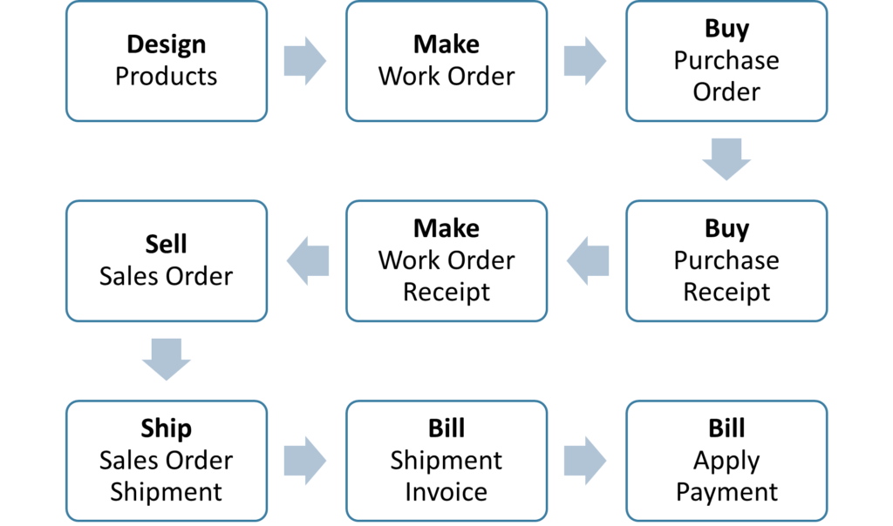
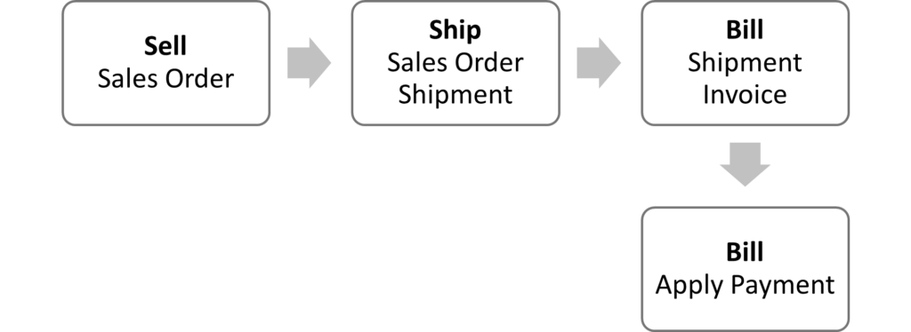
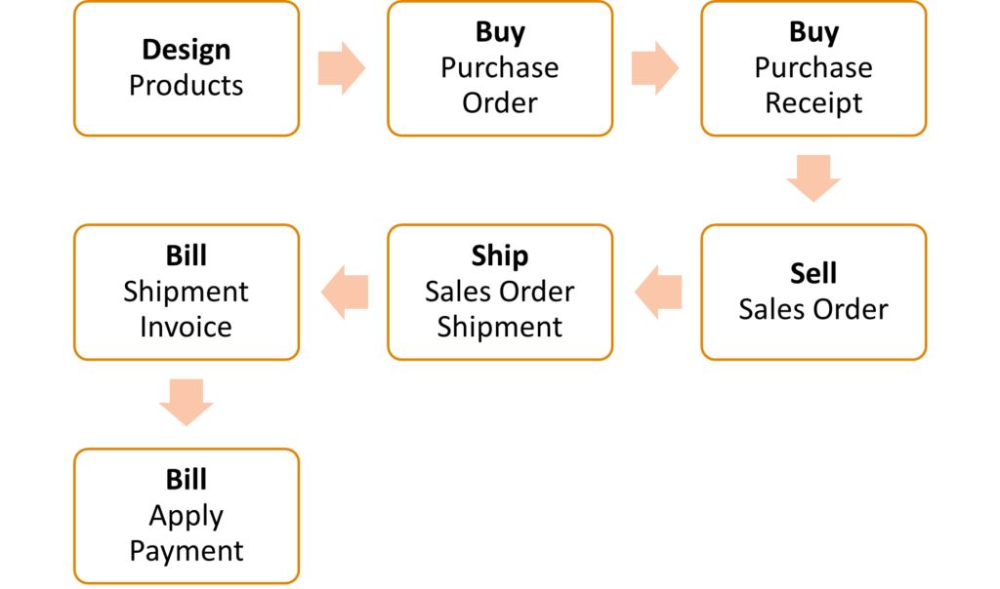
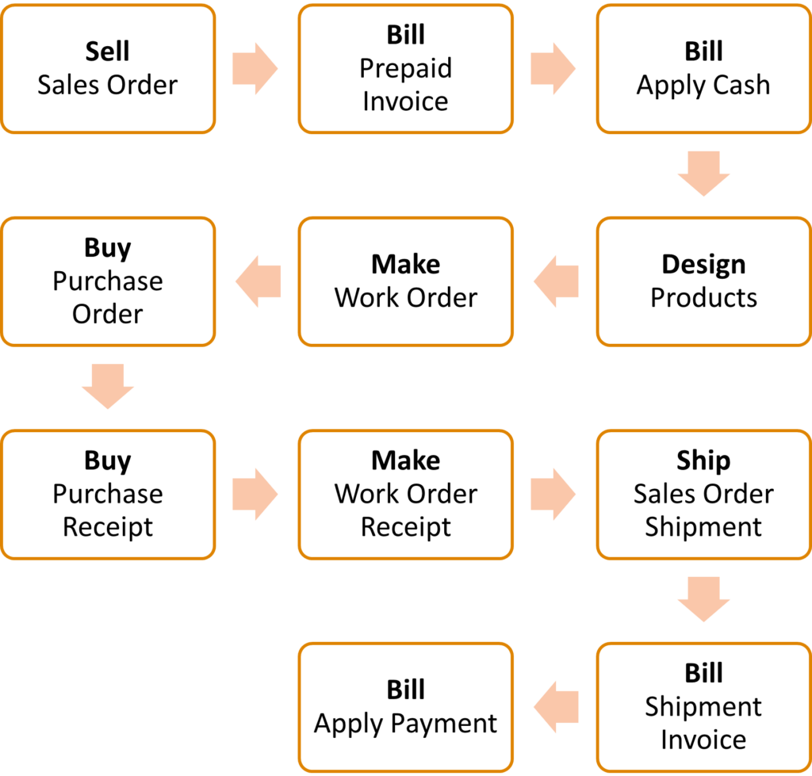

# The order to cash life cycle

Job Shop helps small to medium-size businesses monetize their business by helping to coordinate documents, materials and activities involved in making specialized products. This article will explain how Job Shop supports sales, purchasing, manufacturing and billing activities for a variety of business models.

The diagram below shows an example of a typical make-to-order workflow in a job shop environment, which in this case assumes all products involved need to be acquired and assembled to ship and complete a sale. The bold word (for example, “Design”) is the workbook where the document type is found, while the word underneath (for example, “Products”) is a particular document type, also known as a feather, within the workbook.

Here you define the products you buy and sell. It includes the bill of material needed to make them, or suppliers for purchased products, and the costs. In the flow chart above, the product being sold is defined before a sales order is created, but it is not unusual in job shops to get an order for the item first, and only then define how to buy or make the parts needed to ship the order.

The sales order is where you list one or more parts you are selling to a customer, including the quantities, prices, taxes, shipment addresses, billing parties and so forth. Sales order lines are a type of demand signal that products are needed to execute business. Products can also be kits, which signal demand for a collection of parts that ship together. Job Shop supports the ability to automatically create work orders to build any necessary products that need to be shipped.

If you require a deposit to start work, or use any form of milestone billing, you can optionally create a prepaid invoice to send to the customer for collecting payment before products ship.

You can also optionally print or send an order confirmation document to customers so they know when they can expect you to ship the order

In the flow diagram above, a demand signal was created to buy parts for manufactured products being sold. In this case, we create a purchase order in response to fulfill that demand. A purchase order defines who we are buying from, what we are buying, how many, the price of the parts, and expected receipt date so we can keep track of what products are coming and when.

Job Shop enables you to print and send purchase order documents to suppliers.

When the purchased products arrive, we record a purchase order receipt, which automatically increases the on-hand inventory quantity for the products received and reduces the outstanding purchase order quantity. When all quantities are received, the purchase order closes automatically.

A work order describes how and when you want to make products. Work orders may be automatically created when a particular sales order is ready to start. However, they can also be made manually at any time to produce products for inventory.

Work orders copy the bill of materials from the product being made to the work order materials list to signal what products are needed to complete the job. If the materials are not already on hand, you may get a signal to purchase them, or even child work orders automatically created to build parts needed to make the final product. In supply chain jargon these work order materials are known as dependent demands because the product being sold depends on other parts being acquired to make and ship the final product.

You can optionally print a work order traveler document that includes the order number and describes how to do the work.

Once work order products have been manufactured, we need to record their completion. This increases inventory for the products received, decreases inventory of all the materials needed to make it, and reduces the quantity due on the work order. The work order closes automatically when all quantities have been received.

When any or all items on a sales order are ready to ship, you can optionally print a pick list that tells your shipping team what products to gather for shipping. Once this is done, you create a shipment record specifying what parts are shipping (as it is possible and even normal to only ship part of an order). Once this information is complete, you ship (meaning complete) the shipment which then subtracts the parts from inventory, reduces the sales order demand, and even closes the sales order if all quantities have been shipped.

You can optionally print a pack slip to include with the shipment that shows the order number, which parts were shipped and how many. If you have set up Ship Engine integration, you can also print shipping labels to attach to the shipping containers which transport companies can use to scan and track your packages.

From the shipment record you can create an invoice for the parts that are shipped including any additional shipping charges and taxes. If any prepaid invoices were created for the order, they will be applied to and deducted from the shipment invoice. Once created, you can print and send the invoice document to your customer.

Once payment is received you apply it to the applicable invoice which reduces the amount due on the invoice or closes it if it is paid in full.

It’s important to understand that the workflow is flexible to fit your business needs, and that it may even vary from product to product. Below are some additional examples.

Note: in the interest of keeping things simple, all other knowledge pages concerning the order life cycle will use the make-to-order example as a reference.

This is a make to stock workflow from the design cycle, building up inventory, and then taking your first order.

Once you have inventory, however, it’s a shorter cycle to repeat the process until it’s time to reorder.

Some products, such as accessories, may not involve manufacturing at all. After you design them, you simply buy inventory like this.

For a lot of job shops every order is something new. In that case, you’re likely to take the sales order first, then finish up with designing the product before buying material and making it. However, before you even start work you might require payment for the engineering, or a down payment on the raw materials, or both. In that case Job Shop also supports prepayments as shown in this example.

Job Shop can support a wide variety of business workflows. It’s generally a good idea to diagram which ones apply to you on a whiteboard with your team before starting any implementation so you have a clear idea of which modules and functionalities apply in your use case.

> See also[How the item life cycle works](#design-how-the-item-life-cycle-works)[Planning concepts overview](#planning-concepts-overview)[How the purchase order life cycle works](#how-the-purchase-order-life-cycle-works)[How the work order life cycle works](#how-the-work-order-life-cycle-works)[How the sales order life cycle works](#how-the-sales-order-life-cycle-works)[How the shipping life cycle works](#how-the-shipping-cycle-works)How the billing life cycle works
