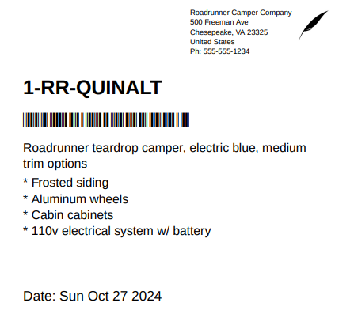
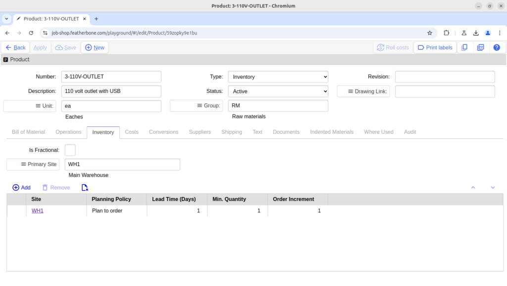
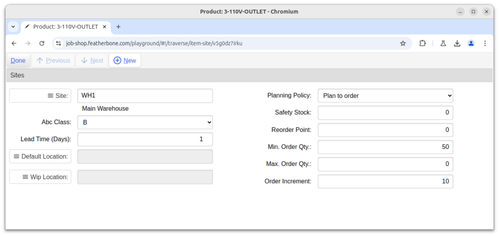
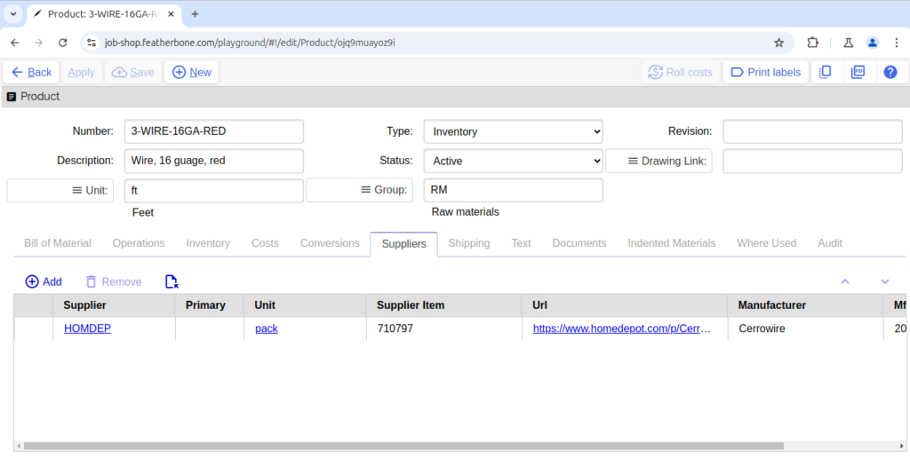
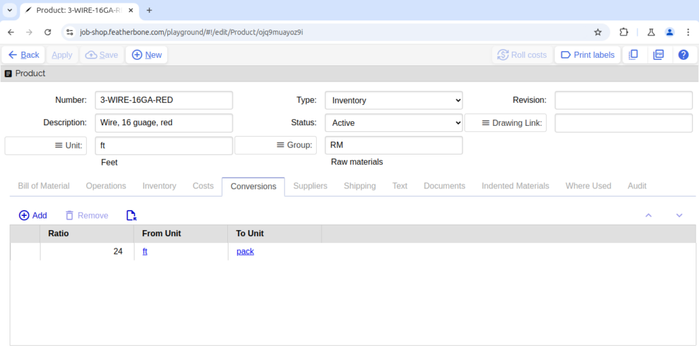
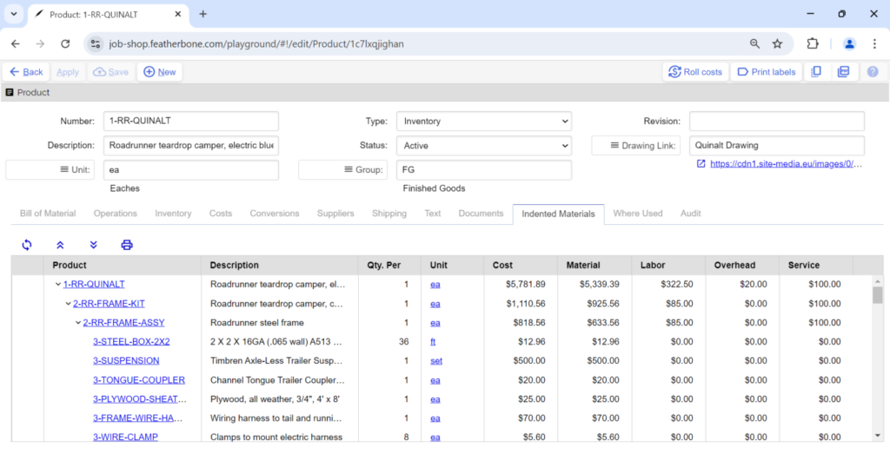
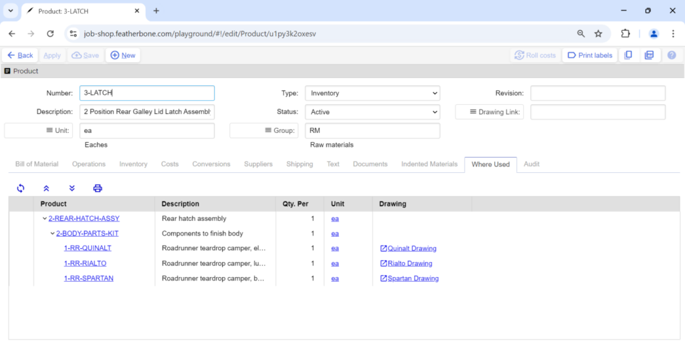

# Products

## Product actions

Will print a standard 4×4 inch label with a barcode that can be used for inventory tracking.

Executing this action will initiate a cost roll-up for the current part.

Read How to roll costs to learn more about this topic.

## Product general attributes

- **Number** — A unique identifier for the product. You can change the number until the time it is shipped, at which point it becomes read only.
- **Unit** — The unit of measure used for tracking inventory. You can only change the unit when there is no active supply or demand for the item, including inventory supply.
- **Type** — There are four types you can set that control inventory behavior of a part as follows:
- **Inventory:** On hand and projected quantities are tracked in inventory. Any purchase or work order receipts for the product increase on hand quantities. Inventory parts are deducted from inventory when listed as materials on a work order and completions or receipts are recorded. See planning for more details on the management of inventory.
- **Expense:** These products are not tracked in inventory. Any purchase receipts for the product update purchase order line receipt quantities, but not inventory. Likewise, expense products listed as materials on a work order only update on the work order level. This is a useful type for consumable parts not worth tracking value for such as paper, tape, and fasteners, but which still need to be purchased, or should be referenced on bills of material and travelers for informational purposes.
- **Kit:** These products are a kind of shorthand to describe a collection of products that you can buy, sell, or include in the work order materials list. When you purchase a kit, and receive it in inventory, then all the constituent parts are received according to its bill of material. Similarly, when you sell and ship a kit the constituent parts of the kit in the bill of material are deducted from inventory. A kit itself, on the other hand, cannot be held in inventory. On work orders the kit product is replaced by all its products on a bill of materials during the work order explosion process. This is convenient if you need to reference the same collection of products on many bills of materials, especially if when the kit is updated, you would like all the bill of materials that call for it to share the update. - **Group** — A general classification that can be used for filtering, sorting, and reporting. There is no business logic dependent on this attribute. - **Status** — Controls the ability to use the product in planning and transactions. See the item life cycle. - **Revision** — Engineering information reference. Job Shop does not track revision history. If it is necessary to differentiate revisions in inventory, then you should use separate product numbers. - **Drawing Link** — A document reference to an external URL or file such as a Drop Box, Google Drive or Microsoft One Drive location. Supported file types are .pdf, .jpeg, .gif, and .png. Job Shop copies the drawing link to any work orders created for the product.

## Product bill of materials

The bill of material (BOM) defines a collection of parts that go into manufacturing a product, or that constitute a kit. Note that all the parts on a bill of material must also have inventory set up for the site where you make, buy or sell the parent product, otherwise Job Shop will throw an error. The common BOM attributes included on the table view in the products form are:

- **Sequence** — Automatic number assigned to the bill of material row, starting from 1. Moving parts up or down in the list will automatically reassign the sequence numbers in order.
- **Product** — A product used to manufacture the parent, or within the kit.
- **Quantity Per** — The number of parts needed for each parent part manufactured, or kit sold or purchased.

Example 1: A part “Bicycle” requires a quantity of 2 tires per cycle. The tires are Inventory parts.

- If the bicycle is an Inventory item, and a work order for 100 bicycles is launched, 200 tires will be required to satisfy making the bicycles. The tires will be deducted from inventory when an operation linked to them is posted, or otherwise when a work order receipt is posted.
- If the bicycle is a Kit product and a sales order is created that calls for 100 bicycles, when the bicycles are shipped, 200 tires will be deducted from inventory.
- If the bicycle is a Kit part and a purchase order is created that calls for 10 bicycles, when the bicycles are received, 20 tires will be added to inventory
- **Fixed Quantity** — A quantity of the part that needed for the parent part regardless of how many parent parts are manufactured, purchased, or shipped. The logic of fixed quantity is the same for manufactured or kit parent parts.

Example 2: A part “Bicycle” requires a quantity of 6 fluid ounces of paint per cycle. However, in the process of painting bicycles, there is always 20 ounces of paint used during startup doing flush and test sprays. The paint is an Inventory part tracked in gallons. There are 128 fluid ounces per gallon.

- If the bicycle is an Inventory item, and a work order for 100 bicycles is launched, 4.84 gallons of paint will be required to satisfy making the bicycles:
- (100 gallons * 6 fl. oz. per cycle + 20 fl. oz. fixed quantity) / 128 fl. oz. per gal. = 4.84 gal.
- The fixed paint quantity will be deducted from inventory when any quantity of operation linked to painting (if it exists) is completed, or otherwise when any work order receipt is recorded.

Example 3: A kit part “Bicycle” requires a fixed quantity of 1 and 0 quantity per assembly instruction booklets.

- If a sales order is created for 100 bicycle kits, one assembly instruction booklet will be deducted from inventory when the bicycles are shipped.
- **Operation number (Op#)*** — This links the material you consume to a specific operation sequence number listed in the operations tab.

These additional attributes are available by opening the BOM detail form:

- **Comments** — Enter free-form text describing additional information about the part.
- **Substitutions** — Every bill of material item may include a list of substitutions that can be viewed by opening row detail. These are alternative products that may be used on a work order in lieu of the normal product referenced on the bill of material in case of shortages or other availability problems. A user who is authorized to edit work orders may switch to using one of the substitution alternatives on the work order up until the time any material has been consumed on the work order.

* Router support available in Job Shop Plus and Enterprise editions only

## Product operations

Operations describe how you route a product through a shop to produce it including what labor and machine resources you require, and for how long. All the time related attributes are used when scheduling a work order. Operations are only available on Pro and Enterprise versions of Job Shop. The common operation attributes included on the table view in the products form are:

- **Sequence** — Automatic number assigned to operation, starting from one. Moving operations up or down in the list will automatically reassign the sequence numbers in order.
- **Description** — Text that prints on the traveler describing what work is being done.
- **Labor Resource** — Assign specific labor resources to perform the work. When this is used, labor costs apply to the time it takes to produce a product.
- **Machine Resource** — Assign specific machine resources to perform the work. When this is used, overhead costs apply to the time it takes to produce a product.
- **Setup Time** — The number of hours required once per work order to set up tooling to start of run of the products.
- **Run Rate** — The amount of time per unit to perform the operation.
- **Run Unit** — Unit of measure for the run rate.
- **Yield** — The percentage of good product output from the operation. This accounts for scrap loss or an expected defect rate in the manufacturing process.

These attributes can be found when opening the child detail form for a given operation on the operations list.

- **Service** — Use to specify an outside process that performs the operation. Outside processes may be tracked by a purchase order, shipping and receiving transactions. Service costs are defined per unit and summarized on cost roll ups.
- **Batch Size** — Used when run unit of “Hours Per Batch” is selected. This value determines the quantity that goes into a batch to calculate timing on a work order.
- **Queue Time** — The average number of hours the work will need to wait in front of the resource before being processed. There are no associated costs with queue time.
- **Wait & Move Time** — Like queue time except calculated to occur after run time and with no associated costs, use these values to account for hours after the operation before the goods can be used in the next one or received into inventory. This can be used to account for cooling, curing, drying or transport time.
- **Transfer Batch Policy & Value** — Use this to define when product that is complete can move forward to the next operation, even while remaining quantities are still processing on the current operation.

These numbers are multipliers used for costing. For example, suppose we have a product “Axle” that needs to be milled on a CNC lathe that requires the operations listed below.

| Operation | Machine Resource | Labor resource | Setup hours | run rate | Machine Capacity | labor capacity | Overhead Cost / Hour | Labor Cost / Hour |
| --- | --- | --- | --- | --- | --- | --- | --- | --- |
| Cut bar | Chop Saw | Shop Labor | 0 | 240 | 1 | 1 | $0.00 | $30.00 |
| Mill Bar | CNC Mill | CNC Oper. | 2 | 60 | 1 | 1 | $25.00 | $40.00 |
| pack | Pack Line | Shop Labor | 1 | 120 | 2 | 4 | $15.00 | $30.00 |

*Axle operations*

The table above shows that we expect one machine and one person for the first two operations, however for the packing operation to run at 120 units per hour, we need two pack lines manned by four people. Therefore, the machine overhead cost will multiply to $30.00 per hour (2 * $15.00) and the labor cost will be $120.00 per hour (4 * $30.00).

## Product site inventory settings

- **Is Fractional** — Use this flag to indicate when you can carry a product in inventory in less than whole units. When this is false, but a fraction of the product is needed, the demand quantity will be rounded up to the next whole number.

For example, suppose you need epoxy to manufacture widgets, and one package of epoxy will manufacture four widgets. “Is fractional” for epoxy is set to false because once you open and mix a package of epoxy you need to use all of it since any unused remaining amount will harden. Therefore, whether you make one widget or four, you need an entire package of epoxy. A work order for one widget will round up, requiring one full package of epoxy. A work order for five widgets will round up requiring two packages.

- **Primary Site** — You must set a primary site for the product to be valid. This specifically describes a warehouse or plant where you specifically use this product. The primary site is the default for work orders, inventory adjustments and other documents. If you do not specifically define a site record for the primary site, Job Shop will create one automatically when you save the product.
- **Sites** — Job Shop allows you to define multiple sites where you can use a product, along with specific behavior for each site as described below.
- **Site** — A manufacturing or warehouse location where the product is used in transactions.
- **Issue method** — The way in which materials are consumed on work orders. The default value for issue method is set in design settings. There are two options:
- **Backflush** — Work order requirement quantities are automatically deducted from inventory either when work order receipts are created and posted, or when when the requirement is associated to the operation and operation completions are reported against it.
- **Manual** — Work order requirements must be manually issued using the work order issue form. Materials can also be returned to inventory when the issue method is manual.
- **Planning policy** — There are three planning policies that work as follows:
- **Reorder point** — Use this for products where you plan to always keep stock on hand. Job Shop will create replenish signals when it is time for you to reorder. Products set to reorder point are not allocated to specific orders. Instead, Job Shop simply nets total demand, supply, and projected quantities. This setting is appropriate for managing inexpensive or commonly used products such as fasteners, sheet metal, and paint.
- **Plan-to-order** — Use this option when you want Job Shop to signal to buy or make products on a case-by-case basis. Job Shop will create planned supply orders allocated to the specific demands that call for them. The planned orders will honor minimum and order increment policies, so Job Shop may create a planned order for more than the initial demand needs. However, it will also continue to allocate other demands to the same planned order until it is fully allocated before creating another one. Plan to order is appropriate for more expensive or specialized products where you prefer to only build inventory when you need it for an active demand, and otherwise want to minimize, if not fully use, the amount kept on hand.
- **Make-to-order** — This option is only available for products with the source set to manufactured. This works similar to plan-to-order except work orders are created, exploded and planned on the fly. As such, child work orders will continue being made recursively down each level until all make to order demands have been fulfilled.
- **Lead time** — The typical number of days it takes to acquire the product at this site, whether manufactured or purchased. Lead time is used to calculate an estimated promise date in order entry, and for calculating scheduled requirement and due dates for child work orders and planned orders.
- **Minimum Order Quantity** — The default minimum make or buy quantity when creating planned orders or work orders for the product.
- **Order increment** — Also known as “lot size” in manufacturing jargon, planning for purchase orders and work orders will be done in multiples of this number.

For example, the case above that describes epoxy used in making widgets may be the sort of reasoning behind using order increment. It may, for example, make sense to set an order increment of 4 for widgets to minimize the waste of epoxy.

Additional attributes are visible when you open the detail form for a product site row.

- **ABC Class** — Used in physical count to categorize products that can be included in the count. Typically, “A” parts are fast moving products, and “C” are slow moving.
- **Default Location†** — If location control is turned on for the site, this specifies a default location for receipt and adjustment transactions.
- **WIP Location†** — If location control is turned on for the site, this specifies a default location from which inventory is depleted for material requirements on work orders. Note that products quantities need to be transferred to this location with the Move transaction.
- **Safety Stock** — For use item sites with a planning policy of reorder point, safety stock is meant to account for volatility in inventory due to miscounts, bad products, accidents and other unexpected events. Safety stock is automatically subtracted from the quantity on hand when calculating projected quantity, reorder and shortage signals to help offer protection against unexpected stock outs.
- **Reorder point** — For use item sites with a planning policy of Reorder Point. When current or projected inventory falls below this number, inventory records will appear on the reorder worksheet.
- **Maximum order quantity** — This number dictates when one planned order or work order is split into multiple orders.

† Enterprise edition only

## Product cost attributes

- **Source** — Used for cost roll ups to determine whether to consider manufacturing or supplier information to determine the cost of the product. It is also used for planning to determine wither planned order should be a planned purchase, planned work order or make to order work order.

This setting only determines default behavior, a product can be either purchased or manufactured at any time.

- **Category** — Used for filtering and reporting only. Category has no business logic impact.
- **Economic Order Quantity (EOQ)** — Used in costing to calculate a typical lot size that considers setup time only being needed once per this number of products. Therefore, this reduces the cost per unit when setup time is a factor.
- **Is Sold** — This flag determines whether the product appears on searches from a sales order.
- **Price** — The default unit price on a sales order.
- **Taxable** — Determines whether a product is taxable by default on sales orders.
- **Material Cost** — Cost based on cost roll ups on purchased products.
- **Labor Cost** — Cost based on cost roll ups on operation labor run time costs.
- **Overhead Cost** — Cost based on cost roll ups on operation machine run time costs.
- **Service Cost** — Cost based on cost roll ups on operations with a service set.
- **Total Cost** — The sum of the above four costs.

## Product conversions

Use product conversions to define product specific unit of measure conversions such as the number of eaches per case for purchasing or use on the bill of materials. Universal conversions such as fluid ounces to gallons or feet per yard should be done using global conversions.

In the example below, we have a product that calls out “pack” as the unit of measure for purchasing wire made by Cerrowire and distributed by Home Depot.

We will not be able to save the product with the supplier record unless the conversion of feet per pack is also defined.

## Product supplier attributes

Here you can define the suppliers you can purchase the product from including the supplier and manufacturer part number, a web address to a catalog page, and price breaks. If there is only one supplier defined, that supplier will be the default for planned orders. If there are multiple you will need to define the which is the primary, or otherwise the first in the list will be used.

Price breaks are set in the supplier item detail form. Planned orders and purchase orders will calculate which price to use automatically based on the quantity ordered if price breaks are defined.

## Product shipping attributes

- **Weight** — The weight is used on shipments to calculate the total weight of shipment, which in turn is used by the Ship Engine integration when generating shipping labels.
- **Container flag and dimensions** — Products where “is container” is flagged true will appear on the list of available containers in shipping. The dimensions on the product are used on the shipment for calculating shipment costs and labels by the Ship Engine integration.
- **Customs information†** — Country of Origin, Harmonized Code, Customs Description and Customs Value are all default values that populate the customs tab on shipments and are used for the Ship Engine label generator for international ship methods.

† Professional and enterprise editions only

## Product text

Text fields provide additional description information that can be used on printed documents.

## Product documents

Besides the drawing, you can link multiple other document URLs for reference concerning the product. Similar to the drawing, document references are copied to work orders at the time of work order creation.

## Indented bill of material

This tab shows a level-by-level view of the bill of material to make analyzing the relationship between complex products and their child products easier. It includes its own printed report (as otherwise this panel does not appear on the product’s PDF print out) and the ability to expand and collapse the whole list, or one product at a time.

## Where used

This panel is the opposite of the indented material list as it shows all the products that a product is used by plus a traversal down to all final products that are impacted by it. In the example below, we can see a latch is used specifically by a hatch assembly, where the hatch assembly is ultimately used in three finished products.

