# Work orders

## Work order actions

Changes the work order to Active status so operation completions and work order receipts can be done against it. Make settings can be configured so that when a work order is released the traveler is automatically printed.

This changes the sales order from Active back to Pending status and thus disallowing transactions.

This causes a work order receipt to be created and posted for the entire remaining quantity of the work order so that all material quantities are issued, all operations are completed and all quantities are received. It is, therefore, simply a way to created the final receipt with fewer clicks.

The forces the work order to change to Closed status. Once it is closed, you can no longer transact against it.

This will print the traveler form designated in make settings. After printing you will be prompted whether the print succeeded. If you confirm yes the Is Printed, Printed Time and Printed By dates will be updated on the work order.

Launch the work order issue form to transact manually issued products to the work order.

Copies the current bill of materials and operations from the work order’s product definition to the work order. If it is not already Pending, this changes the work order to Pending status causing line items to become active demands. All products that require allocated supply are automatically planned. This action my need to be run if the initial explosion failed. For example if one or more of the bill of material items on the product or its children are inactive, the initial explosion will fail.

If the work order was already exploded and it is still pending, the current materials and operations will be deleted and recopied from the product definition. Furthermore any child work orders that were created are also deleted and recreated. This is useful if the product bill of materials is changed and you need pending work order(s) to reflect these changes. However, if any of the child work orders are beyond the pending status, the explosion process will fail with an error. In this case any necessary edits to materials, operations or child work orders need to be made manually.

This action will open the inventory plan form for the selected work order so you can analyze all shop activity for the work order product.

This will cause the automatic planning process to run. This is a good option if the work order’s previous supply plan has been invalidated due to cancelled supply orders, other orders taking the previously allocated supply or some other unexpected situation.

This changes the work order On Hold status to true. When it is in this state you can not transect against it. You will also be prompted whether child work orders should be put on hold so transactions against them will be frozen.

This changes the work order On Hold status to false so you can transact against it. You will also be prompted whether child work orders should be taken off hold so transactions against them can resume as well.

## Work order header

- **Number** — A unique order identifier auto generated on save. All work orders start with “W-“.
- **Product** — The inventory product being supplied by the work order.
- **Site** — The inventory site being supplied by the work order.
- **Status** — The current status of the work order. See article on the work order life cycle for more information.
- **Ordered** — The initial ordered quantity.
- **Received** — The quantity that has been received into inventory.
- **Drawing** — A reference to a drawing document that copies from the product record at the time of explosion.
- **Priority** — Orders with high priority are indicated with red priority text in lists that show this value. Sorting on priority will also sort on High as the highest value and Low as the lowest value. Note that when you change the priority of a work order that has child work orders in the hierarchy this will also change the child work order’s priority to match. Likewise if you change a parent sales order line item priority this will also recursively change the priority of all child work orders to match.
- **Schedule** — The calculation method in which to schedule operations. By default when work orders are created they schedule forward with the difference between the start and end date being determined by the lead time on the product site settings. As a general rule, you should set the lead time with enough time buffer to account for variability within your shop such as capacity fluctuations and the time to complete operations according to Theory of Constraints logic. Operations are scheduled within the band of the lead time.

When work orders schedule forward, you can only edit the start date, and the operations are scheduled to run as soon as possible (ASAP) from the start date as shown.

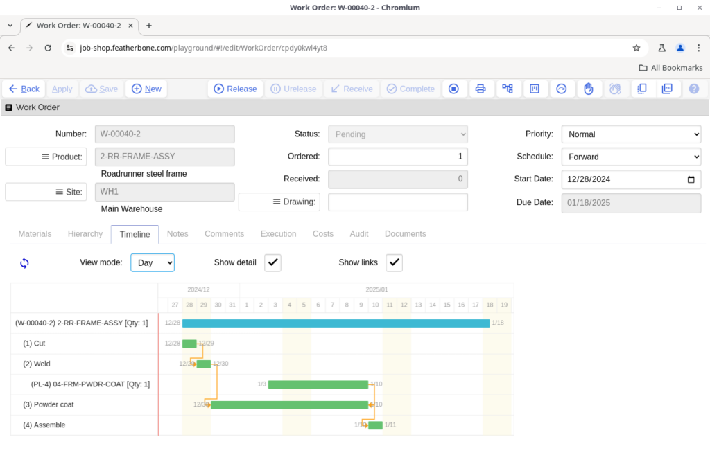

Observe in the image above that the last operation is scheduled to complete on the 11th, while the work order has a due date to finish on the 18th. The difference is the time buffer to account for variability.

When you schedule backward you can only edit the due date and operations are set to schedule as late as possible (ALAP) as shown below, such that the time buffer difference between the work order lead time and the operations appears in the difference between start dates.

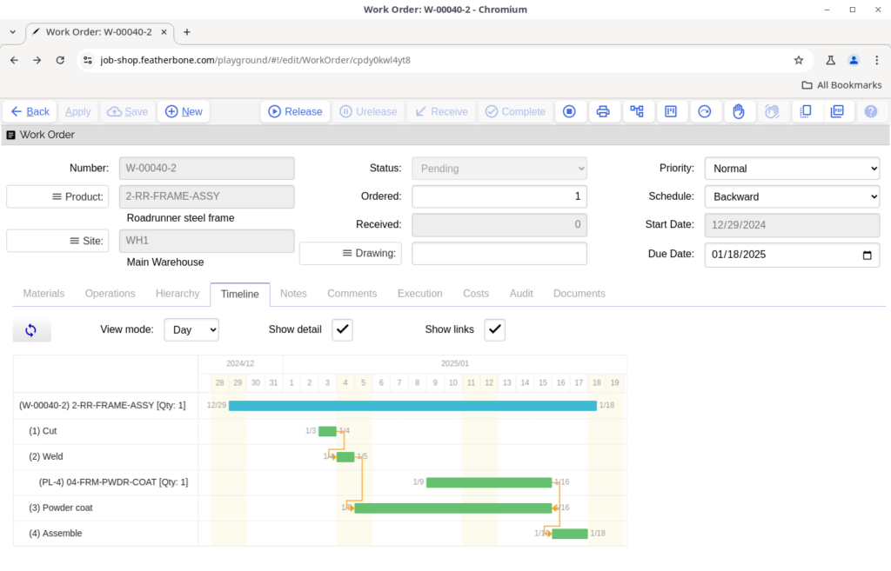

When the schedule type is set to manual operations are scheduled forward, but you are allowed to set both the start and end dates. In this example, the same work order shown above has been rescheduled to start earlier, and also the time buffer on the work order has been reduced to only one day since the due date is now the day after the last operation.

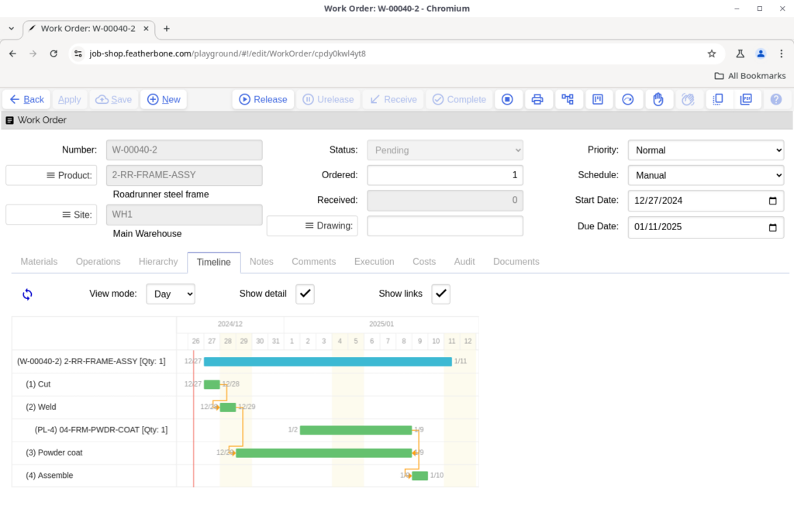

Note: Rescheduling work orders does not change the schedule of planned orders such as the powder coating service shown in the examples above. Planned orders must be rescheduled individually. You can jump directly to them by clicking on their Gantt chart node. After you have saved changes you can refresh the work order Gantt chart to see the revised planned order dates on the timeline.

Job shop does not prevent you from creating a situation where the operation timeline to exceeds the due date of the work order as shown here:

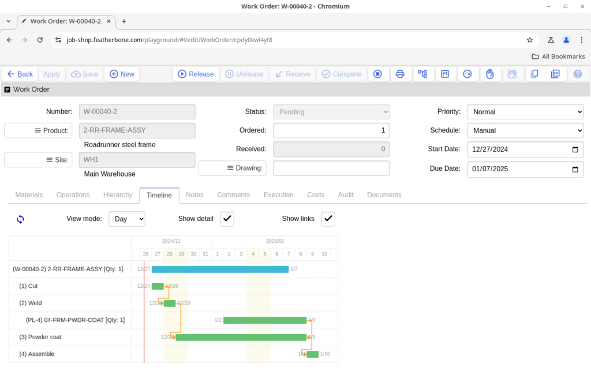

This can also happen even when work orders are being created if the operation run times exceed the lead time set on the product site. In cases like these, the schedule status icon will appear orange as shown below to warn you of a schedule problem.

Hovering over this icon the tool tip will say: “Last operation scheduled is later than the due date.”

- **Start Date** — The day the work order is planned to start. Typically the day you would release it to the floor.
- **Due Date** — The day the work order is needed to satisfy demands that need it.

## Work order materials

The work order materials list defines what products are needed to complete the work order product you are making. It is originally created by copying the product bill of material list when a work order is exploded. This happens automatically when a work order is initially saved.

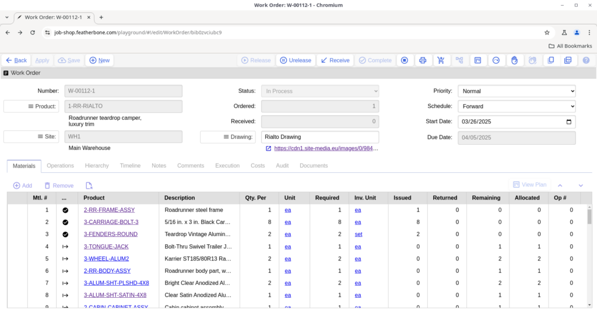

- **View Plan** — This action will open the inventory plan form for the selected product so you can analyze all shop activity for it.

- **Sequence (Mtl. #)** — Automatic number assigned to the bill of material row, starting from 1. Moving parts up or down in the list will automatically reassign the sequence numbers in order.
- **Product** — A material used to manufacture the product being made.
- **Substitutions** — If substitutions were included on the bill of material for the product from which the materials were exploded, the status indicator for the material row will be green. You can can select from one of the alternative products through the usual search which will be limited to the available substitutions. You can use a substitution any time up to the point when materials have been issued.
- **Additions** — The status indicator will be orange for any new products added to the material list.
- **Quantity Per** — The number of parts needed for each parent part manufactured.
- **Unit** — The unit of measure of the quantity per and any fixed quantity required.
- **Required** — The total quantity required in the inventory unit of measure based on the quantity of product being made, quantity per, fixed quantity and the yield rates of operations if applicable.
- **Issued** — The quantity of material issued from inventory.
- **Returned** — Manually issued products that have been returned to inventory.
- **Remaining** — The quantity of material remaining after subtracting the issued quantity from the quantity required.
- **Allocated** — The quantity of material allocated by supply planning.
- **Operation number (Op#)*** — This links the material you consume to a specific operation sequence number listed in the operations tab. If the material is linked to an operation, it is issued when operation completions are reported. Otherwise if zero, then materials are issued based on work order completions.

- **Fixed Quantity** — A quantity of product that is required independent of the number of products being made such as start up scrap loss or one-time use fixtures.

* Router support available in Job Shop Plus and Enterprise editions only

## Work order operations

The work order operations list defines what activities are needed to be done to complete the work order product you are making. It is originally created by copying the operation list when a work order is exploded. This happens automatically when a work order is initially saved.

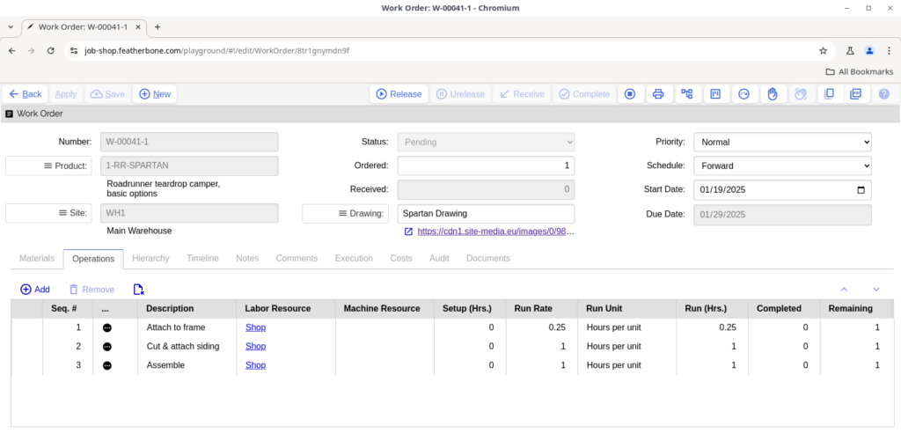

Note: Operations are only available on Pro and Enterprise editions of Job Shop

- **Sequence** — Automatic number assigned to operation, starting from operations. Moving operations up or down in the list will automatically reassign the sequence numbers in order.
- **Description** — Text that prints on the traveler describing what work is being done.
- **Labor Resource** — Assign specific labor resources to perform the work. When this is used, labor costs apply to the time it takes to produce a product.
- **Machine Resource** — Assign specific machine resources to perform the work. When this is used, overhead costs apply to the time it takes to produce a product.
- **Setup (Hrs.)** — The number of hours required once per work order to set up tooling to start of run of the products.
- **Run Rate** — The amount of time per unit to perform the operation.
- **Run Unit** — Unit of measure for the run rate.
- **Run (Hrs.)** — The total calculated time it will take to complete the operation.
- **Completed** — The operation quantity that has been reported as completed either by operation completions or work order receipts.
- **Remaining** — The operation quantity still outstanding to produce. Note this quantity may be greater than the work order quantity being produced if a yield factor on one or more product operations less than 100% has been set.

Additional attributes may be accessed by opening the operation detail form.

- **Service** — Use to specify an outside process that performs the operation. Outside processes may be tracked by a purchase order, shipping and receiving transactions. Service costs are defined per unit produced.
- **Batch Size** — Used when run unit of Hours Per Batch is selected. This value determines the quantity that goes into a batch to calculate timing on a work order.
- **Queue Time** — The average number of hours the work will need to wait in front of the resource before being processed. There are no associated costs with queue time.
- **Wait & Move Time** — Like queue time except calculated to occur after run time and with no associated costs, use these values to account for hours after the operation before the goods can be used in the next one or received into inventory. This can be used to account for cooling, curing, drying or transport time.
- **Transfer Batch Policy & Value** — Use this to define when product that is complete can move forward to the next operation, even while remaining quantities are still processing on the current operation.
- **Machine and labor capacity** — These numbers are multipliers used for costing. See product operations for more details on how this works.

## Work order hierarchy

The work order hierarchy shows an indented structure of dependent demands based on allocations. The dependent work orders may be direct children, as indicated by work orders with the same base number, as the work order you are viewing. However, allocations may exist for plan-to-order work orders as well that have a different base number as shown in the galley assembly below. See the article on planning concepts overview for more information on how allocated supplies are generated.

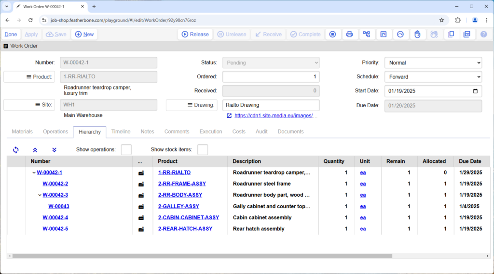

## Work order timeline

The work order timeline tab shows the same information as the hierarchy in a Gantt chart format so you can easily see the relationship of time between work orders. Clicking on any node will open the form for that supply or detail record.

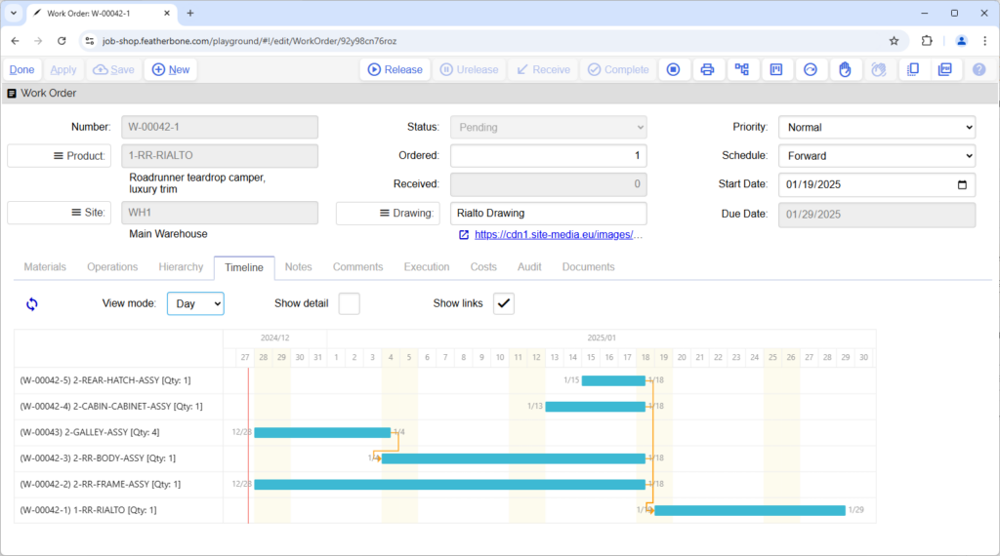

When you check “Show detail,” in addition to work order relationships, the Gantt chart will show operations under their work order header, with planned orders, and purchase orders needed to complete the work order as inputs on the same level as work orders. However, planned purchases and purchase orders for services will display subordinate to the operation that requires them.

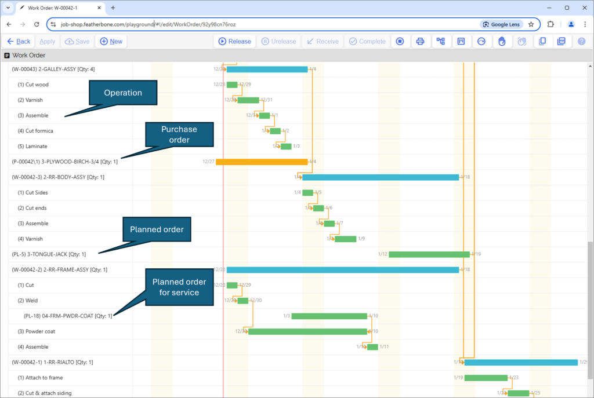

> See alsoCalculate due date on sales order line[Sales order timeline](#sales-order-timeline)Work order schedule type

## Work order notes

Instructions and notes are free form text that print on the work order traveler.

## Work order comments

You can add work order comments for historical tracking of events relating to a work order. Comments will be automatically created when supply gets deallocated for any reason so if, for example, a material that was allocated to the work order was deallocated because the supply was deleted or used elsewhere, you will have a record of how and why that happened and by whom.

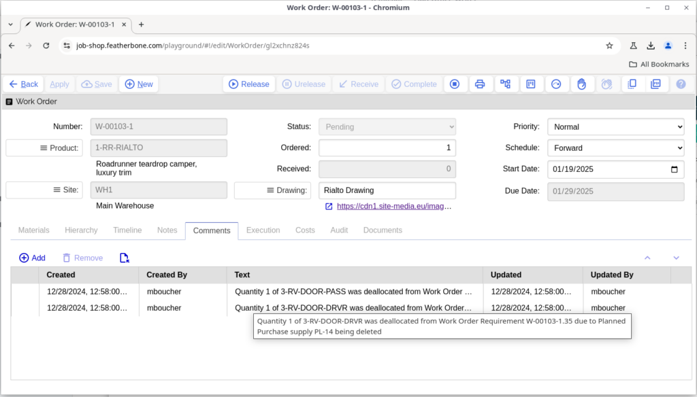

## Work order costs

Costs are used to calculate the estimated production costs, and actual work in progress value of a work order for reporting purposes. The estimated cost is based on the expected operation set up and run time based on the hourly cost for the resources referenced, along with anticipated service and material costs based or requirements. The actual costs are based on the reporting of operation completions and work order receipts. All actual costs assume standard run rates and product costs.

## Work order audit

- **Is Printed** — Flagged true when the traveler has been successfully printed.
- **Created By** — The user account who created the work order.
- **Updated** — The last time the work order was updated.
- **Updated By** — The user account who last updated the work order.

## Work order documents

You can link multiple external resources to a work order. By default, document references are copied from the product record when a work order is created.

## How the work order life cycle works

Work orders are used to keep track of products you are making along with the products, operations and services that are needed to complete the work. Active work orders are shown by default in the work orders worksheet in the Make workbook. You can create new work orders manually from this worksheet, or automatically by converting one or more planned work orders to a work order. Also Job Shop will automatically create work orders for demands for product sites with a planning policy of make-to-order. Work Orders support an explosion process that copies bills of materials and operations from the product being made into the work order, and then automatically plans supply for any materials that require supply allocations. You record the delivery of inbound products with a work order receipt.

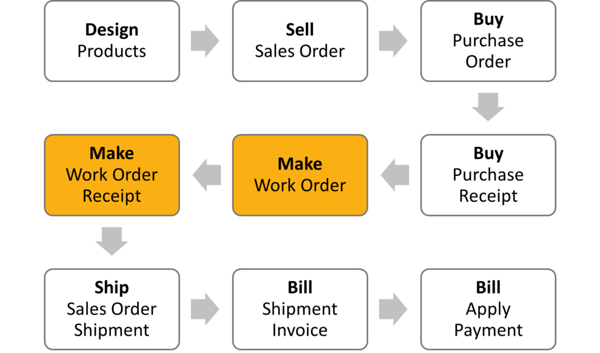

Note: your workflow patterns may differ. See alternate workflows for more information.

Work orders can be in one of the six states shown below, where they generally flow from unexploded to closed, though some statuses are optional depending on the business process.

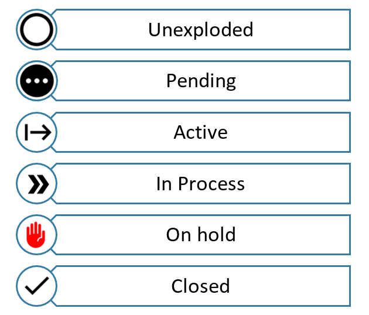

The statuses work as follows:

- **Unexploded** — This is the initial state of a work order before it is saved, but once the save completes the work order explosion process is automatically run.
- **Pending** — This is the initial state of the work order before having been released to the shop. Work orders in this state do not yet appear on dispatch lists and operation completions cannot be recorded against them.
- **Active** — Work orders in this state have been released with travelers presumably printed and on the shop floor. Work orders in this state appear on dispatch lists and operation completions may be recorded against them.
- **In Process** — This is a status that work order will go into if operations have been reported either started or complete or after a receipt is posted if the quantities of items were not received complete.
- **Closed** — The order changes to closed when all quantities have received complete, or if it is manually closed. At this point the work order is read only for historical purposes and no further transactions may be made on it.

> See also[Work order](#work-order-header)How to execute

## Open work orders

By default this lists all active work orders sorted by priority and earliest start date. All work order actions can be performed from selections on this list.

> See also[How the work order life cycle works](#how-the-work-order-life-cycle-works)[Work order](#work-order-header)

## Closed work orders

This is a historical list of closed work orders that can be viewed for investigation and auditing purposes. Closed work orders are read only, so you cannot take any action on them.

## Planned work orders

Planned work orders are created automatically when the Create Planned Order action is run from the shortages and reorder tabs in the Plan workbook, and for inventory products that are set to plan-to-order when sales orders are started, work order materials are exploded, or when the Plan Supply action is run from these demand orders. See the planning concepts overview for more information about planning logic.

Note that there is no demand for the materials or schedule for the operations needed to manufacture a planned work order until it is converted to a work order.

- **View Plan** — This will open the inventory detail form with supporting details as shown below.

  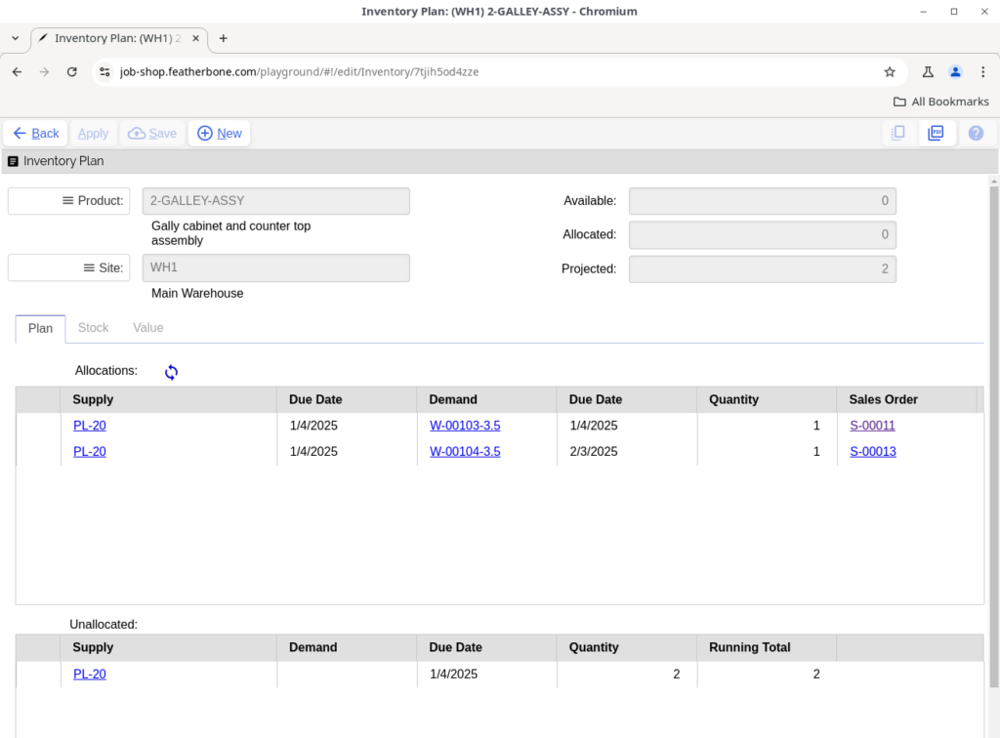
- **Convert** — Convert the selected planned work order or multiple selected planned work orders to work orders which will automatically explode and be scheduled.

The planned work detail form includes the attributes shown below. You have an opportunity to change or amend any of the editable information on the planned order before converting to a work order.

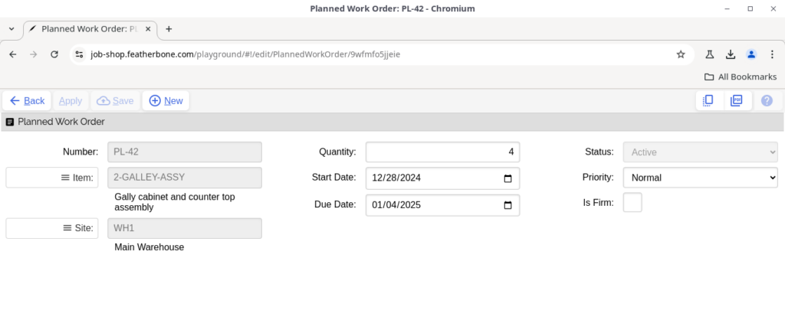

All of the attributes shown above relate to the demand that created the planned order and order quantity rules set on the product’s site record.

## Outside processes

The outside processes worksheet in the Make workbook is a listing of all active outside processes on work orders that require them. You cannot take any actions from this worksheet, it is only informational. Demands for outside processing automatically create planned purchases which you can convert to a purchase order then both ship and receive against it. See how to purchase an outside process for more information.

## Work order receipts

Work order receipts allow you to record the receipt of products against a work order. When posted it decrements the quantity outstanding due on the work order, increments the inventory on hand quantity, and allocations against the work order are changed to inventory allocations. When all quantities are received, the work order closes.

Posting work order receipts also reports operation quantities complete, if not already posted, and backflushes materials required. If operations are completed in the transaction that have materials, the materials associated with those operations will be backflushed. Otherwise if there are any material requirements not associated with operations, they will be back flushed in proportion with the quantity received.

This function records the transactions associated with a receipt as described above. Posting happens automatically when a receipt is saved. However, if the posting should fail you can use this action to reattempt the transaction. For example, a receipt may fail to post if you have an active physical inventory count underway. In a case like this, you will have to post the receipt after the count is complete. You should also make sure in this case not to include the supply received from that work order in your count.

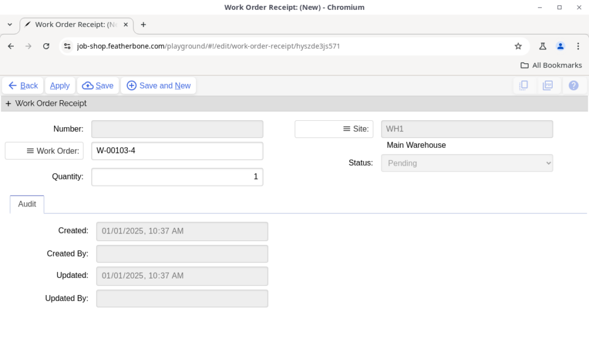

- **Number** — An automatically generated unique identifier. For receipts this number starts with “RC-“.
- **Work Order** — Select a work order to receive. Only active and in process work orders may be selected.
- **Status** — Defaults to Pending. Once posted the receipt status is Received.
- **Site** — The site copies from the work order.
- **Quantity** — Put the quantity you want to receive here.

## Make settings

- **Default Status** — The status a work order should go to when it is initially saved and exploded.
- **Traveler** — The layout to use when printing work orders.
- **Print On Release** — When set to true, a traveler automatically prints when a work order is released.
- **Automatic Close** — When flagged true, work orders will automatically close when the quantity received is greater than or equal to the quantity that was ordered. Set this to false if you need an opportunity to do final book keeping after all quantities are complete, such as material issues transacted manually after the fact or the return of unused materials to inventory that were issued to the work order.
