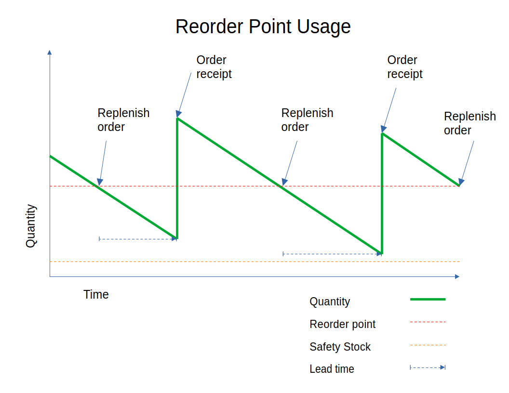
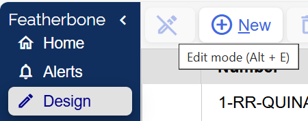
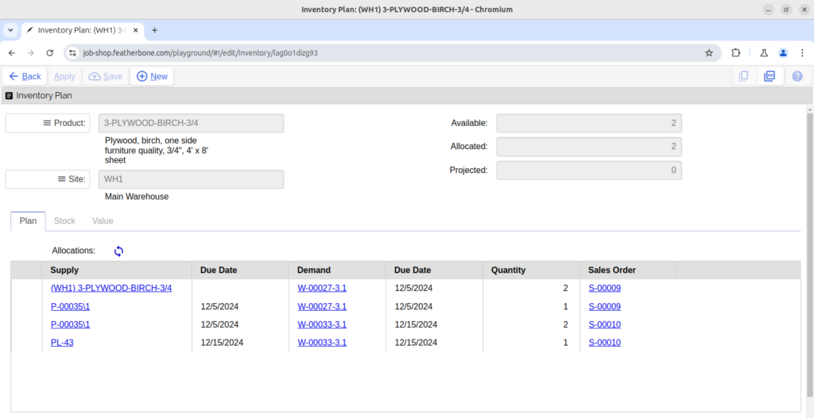
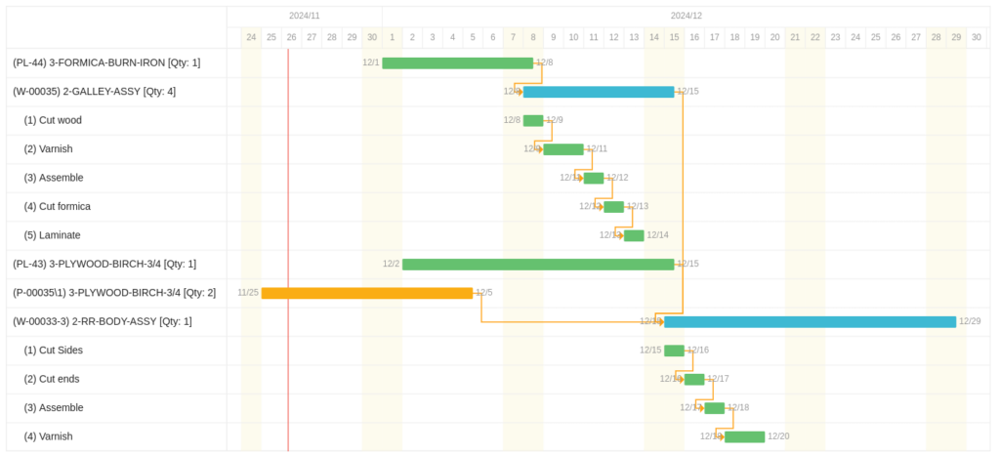
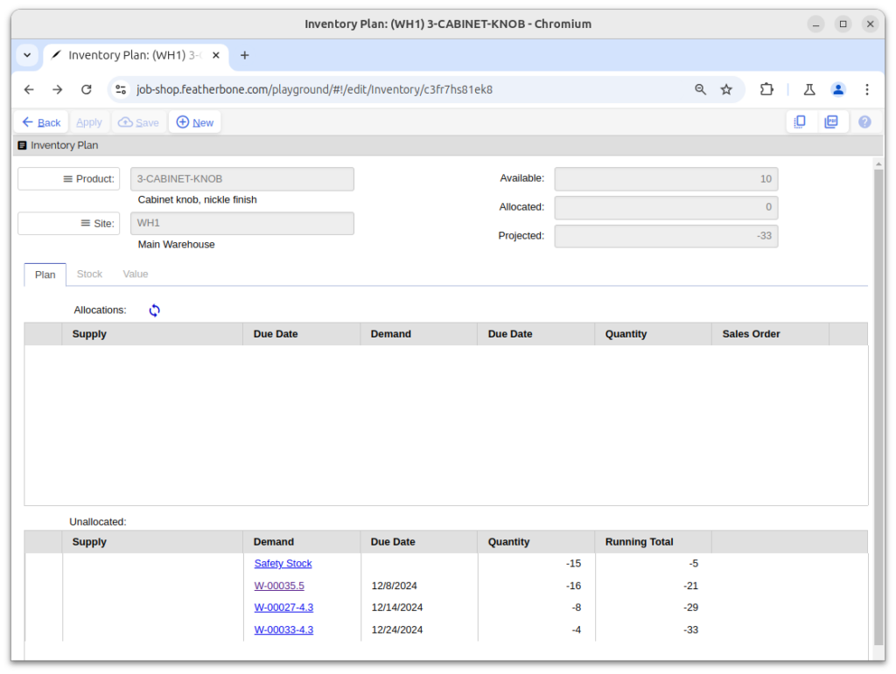
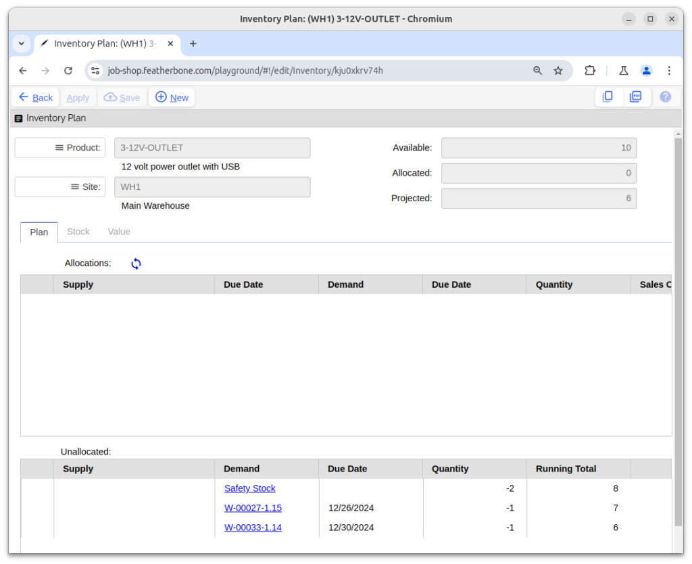

# Planning

## Planning concepts overview

Job Shop has a heavy emphasis on material planning because having materials on hand to work with is both physically necessary and is often one of the most difficult things to manage when a shop starts to get busy and complicated. Pro and Enterprise editions also support operational planning to help work out lead times and task lists using lead time buffers to manage the ebb and flow of capacity availability.

There are effectively three ways to manage planning in Job Shop. We’ll list them here from the least to most sophisticated.

Sometimes it is useful to call out a product on a bill of materials that is helpful for costing and shop floor information on a traveller, but it is not worth keeping track of stock levels in detail. Examples of these kinds of products are adhesives, tapes, paper, spacers, labels and other consumable materials. In this case you should set the product type as expense so that it can be referenced on bills of materials, purchased or even sold, without involving the overhead of tracking quantities in inventory. Actual replenishment of these products will need to be done offline using kanban, paper reorder forms or some other physical system.

Products with the type set to inventory and planning policy set to reorder point appear on shortage and reorder worksheets when stock quantities are currently or projected to fall below the reorder point quantity set on the product site inventory settings. The chart below shows how reorder point managed inventory fluctuates over time. As stock draws down and hits the reorder point, planners are triggered to launch a new supply order which could be either a purchase order or a work order. Typically new supply has a lead time of days, weeks or even months to process before it is received in inventory. Therefore the reorder point quantity should allow enough time for a supply order to be delivered, based on historic usage rates and lead times, before it falls below its safety stock.

Stock managed by reorder point is tracked anonymously within inventory. In other words Job Shop does not keep track of whether any particular inventory supply “belongs” to a demand that needs it. Typical candidates for reorder point management are products that have significant lead time, predictable usage and modest value. Examples of products that might be good candidates include common lumber and sheet metal, paint, fasteners, hardware and wire.

When the planning policy for inventory products is set to plan-to-order or make-to-order then demands for these products are allocated to specific supplies. For example, in the screenshot below we have a sales order supply timeline where there are allocations between four work orders that visually help us understand their relationships to one another. The assemblies on work orders W-00027-2, W-00027-3 and W-00027-4 are all allocated to the material requirements for the finished assembly on W-00027-1 which in turn is allocated to satisfy sales order S-00009\1 demand itself.

Similarly, allocations support the hierarchy view in work orders as shown below:

Finally, when viewed from the inventory detail form, as shown below, allocations can be helpful to determine where supplies are going.

In the above example, 2 sheets of plywood in inventory are allocated to work order W-00027, while the third sheet for that demand is supplied by purchase order P-00035. This same purchase order has two sheets allocated to work order W-00033 and finally there is a planned order for 1 sheet which still needs to be purchased. All of these allocations link to the most downstream sales order that requires them (if applicable), and you can easily jump to any of the supplies, demands or sales orders by clicking on the hyperlink to find out more information about it.

Allocation based planning is best for infrequently used or expensive inventory products where you prefer to make or buy only what is necessary to satisfy active demands. Examples include low volume sub assemblies, specialty wood or metals, electronics, servo motors, and exotic valves.

Product sites set for plan-to-order and make-to-order are automatically planned when demand is in a ready state. For sales orders this is when status moves from incomplete to pending or released. For work orders this happens when they are exploded which occurs automatically on the initial save. Automatic planning means the demands are planned as follows:

1. If inventory is available it is allocated to the demand.
1. If there are any active supply orders with unallocated quantity they are allocated to the demand until all supply quantity is allocated or the demand is satisfied.
1. If there is any remaining unfulfilled demand, new supply is created according to the demand product site’s planning policy as follows: - Plan-to-order: One or more planned orders are created for the balance according to order increment and min/max rules. - Make-to-order: A work order is created which is automatically planned recursively following this same process for each allocation based material requirement on the order.

It’s important to understand that allocations in Job Shop are soft which means Job Shop does not prevent an allocated material from being used by a demand it was not originally intended for. For example if work on W-00033 shown in the inventory form above finished before W-00027, Job Shop would automatically deallocate the inventory from W-00027 and issue it to W-00033. Work order W-00027 would signal it needs to be replanned. Email notification can be set up to notify when these kinds of unexpected deallocations happen.

Job Shop uses the lead time on the product site inventory settings to calculate start dates for supply orders to fulfill demand by calculating backwards from the due date. The philosophy of lead times is that they should include a time buffer to account for unexpected events and capacity fluctuations to ensure products are available at the time they are needed. The example timeline below illustrates this behavior.

Some observations about the above timeline:

- **Work order start and end date:** — W-00033-3 has a lead time of 14 days so is scheduled to start 14 days before its due date.
- **Upstream work orders:** — W-00035 has a lead time of 7 days, so is scheduled to start 7 days before W-00033-3 needs it.
- **Operation times:** — Both work orders have a series of operations that together take less time to complete than the lead time, and by default they are planned to start as soon as possible. The difference between the operation time and lead time is time buffer to handle uncertainty in the shop.
- **Planned purchase lead times:** — The planned order for purchased part 3-FORMICA-BURN-IRON has a 7 day lead time and needs to be purchased by 12/1 to be available to start 2-GALLEY-ASSY. Similarly, 3-PLYWOOD-BIRCH-3/4 needs to be purchased by 12/2 for 2-RR-BODY-ASSY.
- **Active purchase orders:** — Purchase order P-00035 was placed 11/25 and was already in process. It has been allocated to W-00033-3 and with a planned arrival of 12/5 will be available well before it is needed.

The above orders are all scheduled according to default lead times. However, any one of the orders listed may be manually replanned to override the default based on more realistic or more current information.

Re-planning orders with demand is done by running the Plan Supply action on sales orders or work orders which runs the logic described in automatic planning above. Individual supply orders can be moved in time by changing the start and due dates on the supply order records. Note that on purchase orders the order date is the start date and the confirmed delivery is the due date.

## Shortages

The shortage worksheet in the plan workbook shows the same information as is shown in the stock inventory worksheet except that it is pre-filtered on inventory where shortage equals true. A shortage is any inventory record where the projected quantity is less than zero.

Generally you should only expect reorder point managed inventory to appear on this list since allocation based planning policies automatically plan. However, usage of allocated inventory for unplanned purposes could still cause those products to appear as well if they need replanning.

The shortage worksheet includes these actions to aid in planning.

This will open the inventory form as shown below with supporting details.

This will start a planned order by opening and populating a form that both fulfills the quantity necessary to replenish inventory back to its reorder point, and following order increment, min and max rules. If it is a product with the source set to purchased, it will be a planned purchase order with supplier information populated from the prefered supplier using their pricing structure and unit of measure. If it is a product with the source set to manufactured, a planned work order will be created.

This action will start a work order by opening and populating a form with the replenished quantity populated according to order increment, min and max rules.

## Reorder

The reorder worksheet in the plan workbook shows the same information as is shown in the stock inventory worksheet except that it is pre-filtered on inventory where reorder equals true. Reorder is true for any inventory record where the projected quantity is less than the reorder point set on the product site settings.

Generally you should only expect reorder point managed inventory to appear on this list since allocation based planning policies automatically plan. However, usage of allocated inventory for unplanned purposes could still cause these products to also appear here if they need replanning.

The reorder worksheet includes these actions to aid in planning.

This will open the inventory detail form with supporting details as shown below.

This will start a planned order by opening and populating a form that both fulfills the quantity necessary to replenish inventory back to its reorder point, and following order increment, min and max rules. If it is a product with the source set to purchased, it will be a planned purchase order with supplier information populated from the prefered supplier using their pricing structure and unit of measure. If it is a product with the source set to manufactured, a planned work order will be created.

This action will start a work order by opening and populating a form with the necessary replenishment quantity populated according to order increment, min and max rules.

## On order

The on order worksheet shows all active supply orders including purchase and work orders. This list can be useful if you are looking to filter on a specific list of orders for research and print outs.

## Demand

The demand worksheet shows all active demand orders including sales and work orders. This list can be useful if you are looking to filter on a specific list of orders for research and print outs.

## Allocations

The allocations worksheet lists all allocations between supply and demand in the system. This list can be helpful for doing analysis and printing lists. Allocations can be manually deleted or created from here, though using the plan supply actions on work orders and sales orders for this kind of work is much more convenient and less error prone.

This is a batch process that creates allocations for all existing demand for plan-to-order and make-to-order products where the demand is not fully allocated. You will be prompted with a dialog that includes the option to clear allocations first. If the clear allocations option is checked, then all product allocations are deleted and allocations are regenerated in demand due date and supply due date order.

Note this process only creates allocations, it does not generate new supply the way the plan supply action does on demand orders.

Use this action to delete all product allocations. This can be helpful in cases where you’d like to “clear the board” of allocations because chronic order juggling has created something of a mess over time.

Note clearing allocations does not affect service allocations which are hard linked. Service allocations should only be removed by deleting or closing related supply or demand.

## Plan settings

The time between when supply is due to be available and when shipment is planned. This is used for calculating due dates for sales orders. Adding a time buffer helps take into account uncertainty (i.e. Murphy’s Law) since manufacturing does not always go as planned.
