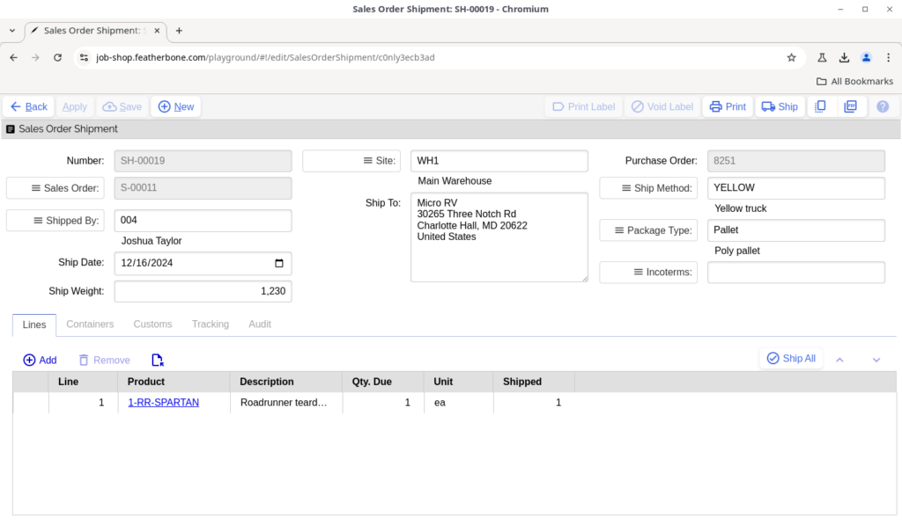
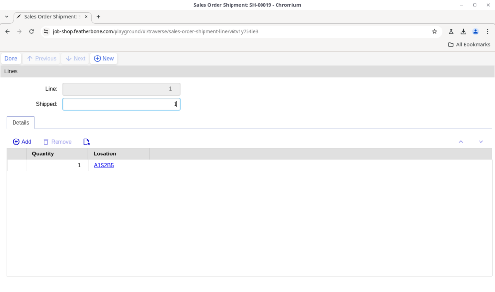
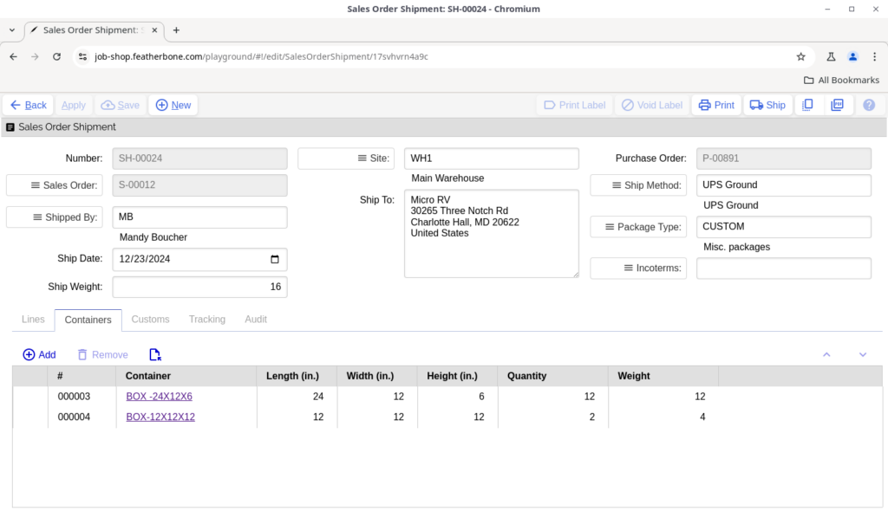
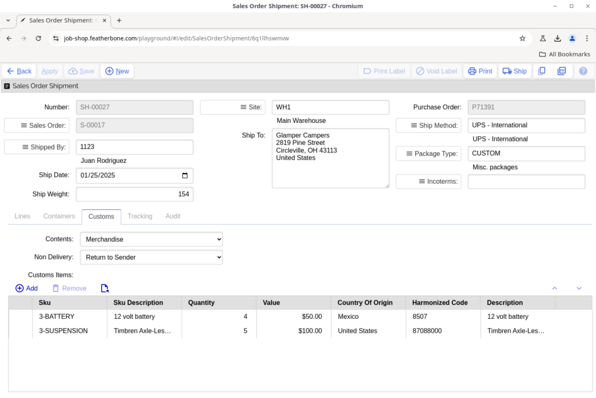
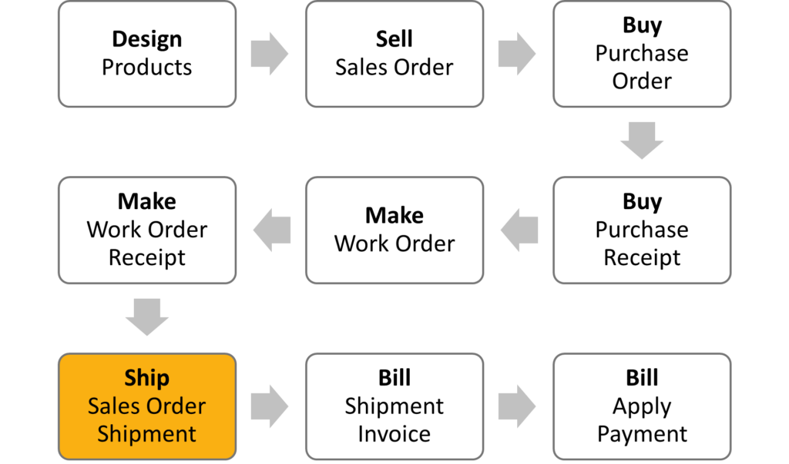
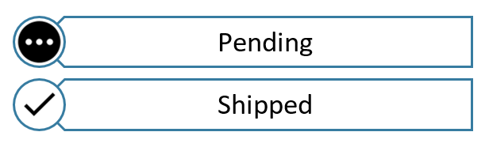
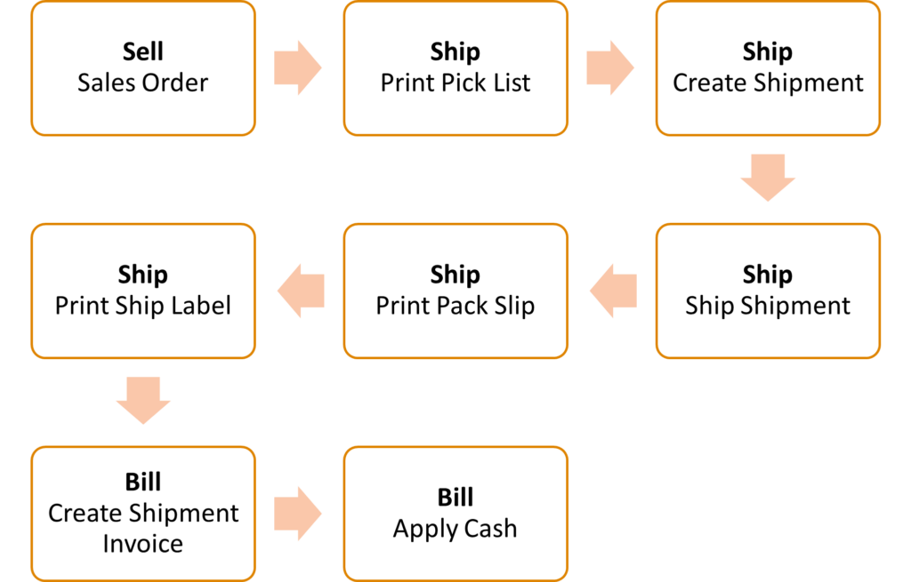

# Shipping

## Sales Order Shipment Actions

- **Print Label** — If Ship Engine integration is enabled, this will create and print a ship label on demand. If a ship label was already created, it will reprint the label.
- **Void Label** — If Ship Engine integration is enabled, this will void the created ship label. See Ship Engine’s documentation on the policy of crediting refunds for voided labels.
- **Print** — Prints a pack slip using the form specified in ship settings.
- **Ship** — Completes the shipment transaction which in the case of an outside process shipment includes:
- Incrementing shipment quantity on the sales order lines.
- Sales order status changes to closed if all quantities are shipped, or either back ordered or released if quantities remain due, depending on the configuration is ship settings.
- Decrement quantities from inventory.
- Printing a ship label if ship settings are flagged to do so.
- Printing a pack slip if ship settings are flagged to do so.
- Marking the shipment as shipped and lines as read only.

## Sales order shipment header

- **Number** — A unique order identifier auto generated on save. All shipments start with “SH-“.
- **Sales Order** — Sales order against which the products are shipping.
- **Shipped By** — The employee who physically shipped the order.
- **Ship Date** — The date the order is scheduled to be or was picked up.
- **Ship Weight** — The sum of the weights of the products shipped any their containers. If Ship Engine integration is enabled, this will facilitate cost calculations for the shipping provider.
- **Site** — The site the shipment is shipped from. Copied from the sales order. Inventory will be deducted from this site when the shipment is shipped. If Ship Engine integration is enabled, this will also facilitate cost calculations by specifying the distance from the shipping start location.
- **Ship To** — The address the shipment is being shipped to. If Ship Engine integration is enabled, this will print on the ship label and facilitate cost calculations for the shipping provider by calculating distance from the shipping location.
- **Purchase Order** — A document reference from the customer, usually their purchase order number. Copies from the sales order.
- **Ship Method** — The ship method copies from the sales order record and indicates how the order will ship. If Ship Engine integration is enabled, it will dictate what shipping provider to create a ship label against and the cost..
- **Package Type** — If Ship Engine integration is enabled, this will facilitate cost calculations for the shipping provider.
- **Incoterms** — The incoterms copy from the sales order and define the responsibilities of exporters and importers in the arrangement of shipments and the transfer of liability involved at various stages of the transaction.

## Sales order shipment lines

- **Ship All** — Populate all lines with the remaining quantity due to ship on the order.

- **Line** — Auto generated sequential line number.
- **Item** — The the product or products being shipped.
- **Shipped** — The quantity being shipped on this shipment.

Additional attributes are visible when opening up the line-item detail form.

- **Details** — The quantity and location the items are being shipped from. Only available on enterprise edition and required when location control is enabled on the ship from site.

## Sales order shipment containers

When using Ship Engine integration, specific containers provided by your carrier, including envelopes and box types, will be imported that you may select as package types. These package types are used for generating ship labels and shipment costs on your shipment since the carrier knows the exact dimensions of the package. However, if you do not use a standard package type supplied by your carrier, you will need to select the CUSTOM package type and specify the of containers and weights used so a shipment label may be generated. Note that some carriers only allow one container per shipment. This is not a limitation of Job Shop, but rather a limitation of the shipper’s label processing system.

- **Number (#)** — Automatically generated container number.
- **Container** — A product with the flag Is Container set to true. When selected, the length width and height dimensions of the product will be referenced in the container row, which in turn is used for creating shipment labels.
- **Quantity** — The quantity of items within the container based on the sum of quantities entered in the container quantities child table.
- **Weight** — The weight of the container.

- **Product quantities** — You can optionally add the quantity detail of products that are in each container. When you do this the shipment line quantities will be automatically be updated, so if you choose to enter container quantity detail this should be the only place you enter quantities. If you accidentally update shipment quantities such that they don’t match the container quantities, you will not be allowed to save the shipment until this is corrected. However, if you don’t enter container quantity detail at all, this check will be skipped.

## Sales order shipment customs

The customs tab on sales order shipments is relevant when the ship method is flagged as international. When this is the case, Contents and Non-delivery attributes are required and customs information corresponding with the products being shipped should be populated. Ship Engine integration requires customs information to generate shipping labels on international ship methods.

In Pro and Enterprise editions of Job Shop default customs information concerning country of origin, harmonized code, customs description and value of products can be set on the product shipping tab. When this is done customs items will be filled in automatically according to the products being shipped on the shipment.

## Sales order shipment tracking

When Ship Engine integration is enabled, the information on this tab will be automatically populated when a label is created.

- **Label Id** — A read only unique label identifier created by Ship Engine when a label is printed. If you need to reprint a label, this identifier is used as a reference determine which label is being reprinted.
- **Tracking Number** — The carrier’s tracking number automatically populated when a label is printed. This can be manually entered, or scanned in with a keyboard wedge bar code reader, if you are not using Ship Engine integration.
- **Label Void** — Read only indicator that flags to true when a printed label is voided. If the label is void and you print a label, a new label will be created with a new identifier and tracking information.
- **Tracking URL** — The URL that can be used to see the tracking status of the shipment on the carrier’s website.

## Sales order shipment audit

- **Created** — The time the shipment was created.
- **Created By** — The user account who created the shipment.
- **Updated** — The last time the shipment was updated.
- **Updated By** — The user account who last updated the shipment.
- **Is Printed** — Flagged true when the shipment has been successfully printed.
- **Print Time** — The time the shipment was successfully printed.
- **Printed By** — The user account who successfully printed the shipment.

## How the shipping cycle works

Sales order shipments record when some or all products on a sales order are shipped. Typically, a pack slip is printed and packed with the order so the customer can confirm what has been delivered. If Ship Engine integration is enabled, you may also print ship labels for your carrier. Both the pack slip, and ship labels can be configured in ship settings to print automatically when a shipment is shipped.

Note: your workflow patterns may differ. See alternate workflows for more information.

Sales order shipments can be in one of the two states shown below, where they flow from pending to shipped.

The statuses work as follows:

- **Pending** — This is the initial state of the shipment while you are actively working on it. Any quantity edits on a shipment in this state don’t yet change inventory quantities.
- **Shipped** — The shipment changes to shipped when the Ship action is run on the shipment. At this point shipment quantities in inventory have been deducted and one or more inventory transactions have been made. After the shipment has been shipped it is read only.

The standard order cycle above doesn’t show the detail that may be involved in your shipping process. The diagram below shows additional process detail you can use for shipping orders.

- **Sell Sales Order** — Create a sales order for the products to be sold.
- **Ship Print Pick List** — The pick list can be printed from the orders due worksheet in the Ship workbook to direct floor staff what products to gather to ship for the order.

Note unless the worksheet filter is changed otherwise, the order must be eligible to appear on the list to print.

After the pick list has been printed, the order will appear in the on floor worksheet. - **Ship Create Shipment** — From the pending shipments worksheet click New to create a new shipment and select or scan the sales order number. Saving the shipment put the sales order in the Shipping status while quantities are being pulled and other shipping information is gathered. - **Ship Ship Shipment** — When the shipment is ready, execute the Ship action to complete the shipment. - **Ship Print Pack Slip** — The ship settings can be configured to automatically print the pack slip at the time a shipment is shipped. Otherwise the pack slip can be printed manually any time before or after shipment. The difference with the pack slip from the pick list is that it has the quantity printed that was actually shipped on the order, which may or may not show a back order quantity depending whether it was shipped complete. Typically either the pick slip with the actual quantity written in, or the printed pack slip get attached to the package being delivered to the customer. It is a business decision which you prefer to use for this. - **Ship Print Label** — The ship settings can also be configured to automatically print the ship label at the time a shipment is shipped, but like the pack slip this can otherwise be done manually any time before or after the shipment is shipped. However, to print a label you must have the Ship Engine configuration set up. - **Bill Create Shipment Invoice** — Once the shipment is shipped, it will become eligible in the Bill workbook on the uninvoiced shipments worksheet. Select the shipment and run the Create Invoice action to create and print the invoice. - **Bill Apply Cash** — When payment is received, you can apply it to the invoice from the active invoices worksheet by running the Apply Payment action.

> See alsoHow the sales order cycle works[Sales order](#sales-order-header)Sales order shipment[How the billing cycle works](#how-the-billing-cycle-works)Invoice

## Orders due

The orders due worksheet lists all sales orders eligible for shipping. The purpose of this worksheet is review eligible orders and print pick slips to direct shipping staff to pick and pack orders for shipping.

By default orders eligible to appear on this list meet the following criteria:

- Are released for shipping (status of Active or Backlog)
- Order promise date is on or before the current day
- Pick list printed flag is false
- On Hold status is false

After you print a pick list and confirm the pick list was printed correctly, the pick list printed flag on the sales order is set to true so the order no longer appears on this list, but instead appears on the On Floor worksheet. If a sales order is shipped incomplete, or a shipment record created for the sales order is deleted, the pick list printed flag is changed back to false so it reappears on the orders due list.

Note: If you have update privileges to the ship workbook you can change the eligibility criteria to suit your business needs by changing the filter and sharing your changes as the new default settings.

## On floor

The on floor worksheet lists all sales orders with pick lists printed that have not shipped. The purpose of this worksheet is to help you keep track what is actively being picked and packed for shipping on your shop floor.

By default orders eligible to appear on this list meet the following criteria:

- Are not closed
- Pick list printed flag is true

From this worksheet you have the option to reprint the pick list on any selected sales order. Once a shipment has been created and shipped (or deleted) it will fall off this list.

Note: If you have update privileges to the ship workbook you can change the eligibility criteria to suit your business needs by changing the filter and sharing your changes as the new default settings.

## Pending shipments

The pending shipments worksheet lists all sales order shipments in pending status. The purpose of this worksheet is to help you keep track what is actively pending in shipping on your shop floor.

- **Print Label** — If Ship Engine integration is enabled, this will create and print a ship label on demand. If a ship label was already created, it will reprint the label.
- **Void Label** — If Ship Engine integration is enabled, this will void the created ship label. See Ship Engine’s documentation on the policy of crediting refunds for voided labels.
- **Print** — Prints a pack slip using the form specified in ship settings.
- **Ship** — Completes the shipment transaction which in the case of an sales order shipment includes:
- Increase shipped quantity on the sales order lines.
- Sales order status changes to closed if all quantities are shipped, or changed to either back ordered or active (depending use back order flag on ship settings) if quantities remain due.
- Decrease quantities in inventory.
- Printing a ship label if ship settings are flagged to do so.
- Printing a pack slip if ship settings are flagged to do so.
- Marking the shipment as shipped and lines as read only.

## Shipment history

This is a historical list of sales order shipments that can be viewed for investigation and auditing purposes. Shipped shipments are read only, so no action can be taken on them.

## Ship settings

- **Pick List** — The layout to use when printing a sales order pick list.
- **Print On Release** — When flagged true, a pick list will be printed when a sales order is released.
- **Packing Slip** — The layout to use when printing sales order shipment packing slips.
- **Print On Ship** — When set to true, a packing slip automatically prints when a sales order shipment is shipped.
- **Use Back Order** — When set to true and a sales order is shipped partially, the sales order status changes to Back Order, otherwise it changes back to Active.
